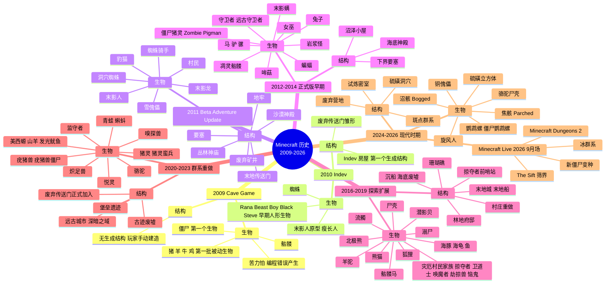

# 10 · Minecraft 生物与建筑结构历史思维导图

> 本文件属于 **Remnant Echo 模组资料汇编** 的剧情扩展章节（`17-lore-extensions/`）。
> 基于 Minecraft 历史（2009-2026）从第一个生物开始层层堆叠，分生物与建筑结构两条线。
>
> **资料优先级**：P1（minecraft.wiki/minecraft.net 官方）+ P2（社区共识）
> **汇编日期**：2026-09-21
> **状态**：🟡 部分待补充调研（2026 新版本资料 API 故障，待重试）

---

## 1. 目的

按项目方 2026-09-21 指示："分建筑结构维度与生物，做一个思维导图，从 minecraft 第一个生物开始，层层堆叠，层层迭代"

本文档按时间顺序整理 Minecraft 2009-2026 的生物与建筑结构演进，作为模组叙事的"历史时间轴"参考。

---

## 2. Minecraft 生物历史时序（2009-2026）

### 2.1 早期开发期（2009-2010）Cave Game / Indev / Alpha

| 版本 | 时间 | 生物 | 备注 |
|------|------|------|------|
| **Cave Game pre-Classic** | 2009-05-10 | 僵尸（Zombie） | Minecraft 历史上第一个生物，最初叫"Monster" |
| **Classic 0.24** | 2009-08-24 | 苦力怕（Creeper） | Notch 编程错误产生（详见 [`02-creeper-origin-and-elements`](./02-creeper-origin-and-elements.md)） |
| **Classic 0.25** | 2009-08-24 | 骷髅（Skeleton） | 第二个加入的敌对生物 |
| **Classic 0.27** | 2009-09-03 | 猪（Pig）/羊（Sheep）/牛（Cow）/鸡（Chicken） | 第一批被动生物 |
| **Indev 0.31** | 2010-01-13 | Rana/Beast Boy/Black Steve/Steve（怪物） | 早期人形生物测试，**后续被移除**（详见 [`11-legacy-mobs-items`](./11-legacy-mobs-items.md)） |
| **Alpha 1.0.4** | 2010-07-09 | 蜘蛛（Spider） | 第一批加入的爬行类生物 |
| **Alpha 1.0.17** | 2010-08-18 | 末影人（Enderman）原型"瘦长人（Slenderman）" | 最初叫"Farlander"，最终命名 Enderman |

### 2.2 Beta 时期（2010-2011）

| 版本 | 时间 | 生物 | 备注 |
|------|------|------|------|
| **Beta 1.2** | 2011-01-13 | 墨鱼（Squid）/狼（Wolf） | 第一批水生+可驯化生物 |
| **Beta 1.4** | 2011-03-31 | 蜘蛛骑手（Spider Jockey，骷髅骑蜘蛛） | 第一批组合生物 |
| **Beta 1.5** | 2011-04-19 | 豹猫（Ocelot） | 可驯化为猫 |
| **Beta 1.6** | 2011-05-26 | 蜜蜂（Bee，早期版本被弃）+洞穴蜘蛛（Cave Spider） | 第一批变种生物 |
| **Beta 1.8 Adventure Update** | 2011-09-09 | 末影龙（Ender Dragon）/末影人/雪傀儡（Snow Golem）/村民（Villager） | 末地+村民加入 |

### 2.3 正式版时期（2011-2016）

| 版本 | 时间 | 生物 | 备注 |
|------|------|------|------|
| **1.0 正式版** | 2011-11-18 | 末影龙/末影人/雪傀儡/村民正式加入 | Minecraft 正式发布 |
| **1.2** | 2012-03-01 | 僵尸猪灵（当时叫"Zombie Pigman"）/岩浆怪（Magma Cube）/哞菇（Mooshroom） | 下界生物扩展 |
| **1.4 Pretty Scary Update** | 2012-10-25 | 凋灵骷髅（Wither Skeleton）/女巫（Witch）/蝙蝠（Bat）/末影螨（Endermite，1.8 加入） | 凋灵+女巫加入 |
| **1.6 Horse Update** | 2013-07-01 | 马（Horse）/驴（Donkey）/骡（Mule） | 第一批可骑乘生物 |
| **1.7 The Update that Changed the World** | 2013-10-25 | 无新生物 | 群系大规模重做 |
| **1.8 Bountiful Update** | 2014-09-02 | 末影螨/守卫者（Guardian）/远古守卫者（Elder Guardian）/兔子（Rabbit） | 海底神殿+末影螨加入 |
| **1.9 Combat Update** | 2016-02-29 | 潜影贝（Shulker）/骷髅马（Skeleton Horse） | 末地城+末地船+鞘翅加入 |

### 2.4 现代时期（2016-2026）

| 版本 | 时间 | 生物 | 备注 |
|------|------|------|------|
| **1.10 Frostburn Update** | 2016-06-08 | 北极熊（Polar Bear）/尸壳（Husk）/流髑（Stray） | 沙漠+雪原不死变体 |
| **1.11 Exploration Update** | 2016-12-12 | 灾厄村民家族（掠夺者/卫道士/唤魔者/劫掠兽/恼鬼）/羊驼（Llama）/羊驼商人 | 林地府邸+灾厄村民 |
| **1.13 Update Aquatic** | 2018-07-18 | 海豚（Dolphin）/海龟（Sea Turtle）/鳕鱼/鲑鱼/河豚/热带鱼/溺尸（Drowned）/幻术师（Illusioner，未实装） | 海洋扩展 |
| **1.14 Village & Pillage** | 2019-04-23 | 熊猫（Panda）/狐狸（Fox）/掠夺者扩展（raid 机制） | 村庄重做 |
| **1.15 Buzzy Bees** | 2019-12-17 | 蜜蜂（Bee）正式加入 | 蜂巢+蜂蜜 |
| **1.16 Nether Update** | 2020-06-23 | 猪灵（Piglin）/猪灵蛮兵（Piglin Brute）/疣猪兽（Hoglin）/疣猪兽僵尸（Zoglin）/炽足兽（Strider）/末影人（末地外岛变体） | 下界大规模扩展 |
| **1.17 Caves & Cliffs Part I** | 2021-06-08 | 美西螈（Axolotl）/山羊（Goat）/发光鱿鱼（Glow Squid） | 群系重做 |
| **1.18 Caves & Cliffs Part II** | 2021-11-30 | 无新生物 | 地形重做 |
| **1.19 The Wild Update** | 2022-06-07 | 监守者（Warden）/青蛙（Frog）/蝌蚪（Tadpole）/悦灵（Allay） | 远古城市+监守者 |
| **1.20 Trails & Tales** | 2023-06-07 | 嗅探兽（Sniffer）/骆驼（Camel） | 考古更新 |
| **1.21 Tricky Trials** | 2024-06-13 | 旋风人（Breeze）/沼骸（Bogged） | 试炼密室 |
| **1.21.5 Backend Changes** | 2025 | 无新生物 | 后端改动 |
| **1.21.6 Craftable Saddles** | 2025-05-13 | 无新生物（新增音乐） | 鞍可合成 |
| **1.21.7 A Minecraft Movie 致敬** | 2025-06-30 | 无新生物 | Lava Chicken 唱片 |
| **1.21.9 The Copper Age** | 2025-09-30 | 铜傀儡（Copper Golem） | 铜器时代 |
| **1.21.11 Nautilus Update** | 2025-10-29+ | 鹦鹉螺（Nautilus）/僵尸鹦鹉螺（Zombie Nautilus）/骆驼尸壳（Camel Husk）/焦骸（Parched） | 鹦鹉螺扩展 |
| **26.1 Tiny Takeover** | 2026-09 | 金蒲公英+幼年生物不老 | 微小侵占 |
| **26.2 Chaos Cubed** | 2026-06-16 | 硫磺立方体（Sulfur Cube） | 混沌立方 |
| **26.3 Wilderness Bound** | 2026-09-15 | 无新生物 | 帐篷+干草床 |
| **Minecraft Live 2026 9月场** | 2026-09 | 冰群系+The Sift+新僵尸变种 | 🟡 待补充调研（API 故障） |

---

## 3. Minecraft 建筑结构历史时序（2009-2026）

### 3.1 早期开发期（2009-2010）

| 版本 | 时间 | 结构 | 备注 |
|------|------|------|------|
| **Classic** | 2009 | 无生成结构 | 玩家手动建造 |
| **Indev** | 2010-02 | 第一个生成结构：小型房屋 | Indev 房屋，后续被移除 |
| **Infdev** | 2010-06 | 第一座村庄门（无完整村庄） | 早期村庄雏形 |
| **Alpha 1.0** | 2010-07 | 第一座废弃传送门雏形 | 早期维度穿行测试 |

### 3.2 Beta 时期（2010-2011）

| 版本 | 时间 | 结构 | 备注 |
|------|------|------|------|
| **Beta 1.0** | 2010-12 | 第一个村庄（无 NPC） | 早期村庄 |
| **Beta 1.8** | 2011-09 | 要塞（Stronghold）+末地传送门+废弃矿井+地牢+沙漠神殿+丛林神庙 | 末地+主世界遗迹加入 |

### 3.3 正式版时期（2011-2016）

| 版本 | 时间 | 结构 | 备注 |
|------|------|------|------|
| **1.0** | 2011-11 | 末地岛+末地城雏形+回归传送门 | 末地正式加入 |
| **1.2** | 2012-03 | 下界要塞（Nether Fortress） | 下界扩展 |
| **1.4** | 2012-10 | 沼泽小屋（Witch Hut） | 女巫加入 |
| **1.6** | 2013-07 | 无新结构 | 马加入 |
| **1.8** | 2014-09 | 海底神殿（Ocean Monument） | 远古守卫者加入 |
| **1.9** | 2016-02 | 末地城（End City）+末地船（End Ship）+折跃门 | 末地扩展 |

### 3.4 现代时期（2016-2026）

| 版本 | 时间 | 结构 | 备注 |
|------|------|------|------|
| **1.10** | 2016-06 | 无新结构（骨骼化石地下化石） | 北极熊加入 |
| **1.11** | 2016-12 | 林地府邸（Woodland Mansion）+掠夺者前哨站（Pillager Outpost） | 灾厄村民加入 |
| **1.13** | 2018-07 | 沉船（Shipwreck）+海底废墟（Ocean Ruins）+珊瑚礁+海带森林 | 海洋扩展 |
| **1.14** | 2019-04 | 村庄重做（多种群系变体）+掠夺者前哨站扩展 | 村庄扩展 |
| **1.16** | 2020-06 | 堡垒遗迹（Bastion Remnant）+废弃传送门正式加入 | 下界大规模扩展 |
| **1.18** | 2021-11 | 无新结构（地形重做） | 洞穴+山脉 |
| **1.19** | 2022-06 | 远古城市（Ancient City）+深暗之域 | 监守者加入 |
| **1.20** | 2023-06 | 古迹废墟（Trail Ruins） | 考古更新 |
| **1.21** | 2024-06 | 试炼密室（Trial Chambers） | 试炼密室 |
| **1.21.9** | 2025-09 | 无新结构（铜器扩展） | 铜器时代 |
| **26.2** | 2026-06 | 硫磺洞穴（Sulfur Caves） | 混沌立方 |
| **26.3** | 2026-09 | 废弃营地（Abandoned Camp）+斑点群系 | 荒野之缚 |
| **Minecraft Live 2026 9月场** | 2026-09 | 冰群系+The Sift 结构 | 🟡 待补充调研 |

---

## 4. 综合历史思维导图（生物+建筑结构，从 2009 开始层层堆叠）

---

## 5. 模组叙事与历史时序的对应

按 [`02-story-timeline-plan`](../planning/02-story-timeline-plan.md) 六大纪元：

| Minecraft 历史版本 | 模组纪元 | 模组叙事关联 |
|--------------------|----------|--------------|
| 2009 Classic | 鼎盛纪元开端 | 第一个生物（僵尸）+苦力怕（编程错误）+骷髅——对应先民鼎盛期三大基础研究 |
| 2010 Indev | 鼎盛纪元发展 | 早期人形生物测试（Rana 等）——对应先民"人形生物改造实验"的早期尝试（后续被弃，对应先民放弃部分实验） |
| 2011 Beta | 鼎盛-灾变过渡 | 末影龙+末影人+村民+雪傀儡——对应先民开拓三界+殖民军+维度穿行技术 |
| 2012-2014 正式版早期 | 灾变纪元 | 凋灵骷髅+女巫+守卫者——对应凋灵之灾+幽匿之厄+苍白之悔三大灾变 |
| 2016-2019 探索扩展 | 大分裂后 | 灾厄村民家族+林地府邸——对应大分裂后拒绝失败的分支 |
| 2020-2023 群系重做 | 现代纪元 | 监守者+猪灵+末影人扩展——对应现代纪元各族演化完成 |
| 2024-2026 现代时期 | 现代纪元+ | 试炼密室+硫磺洞穴+废弃营地——对应现代纪元新遗迹发现 |
| Minecraft Live 2026 9月场 | 待评估 | 冰群系+The Sift+新僵尸变种——🟡 待补充调研 |

---

## 6. 关键时间节点速查

| 时间 | 关键事件 | 模组叙事意义 |
|------|----------|--------------|
| 2009-08-24 | 苦力怕诞生（Notch 编程错误） | 模组叙事：生命本源研究副产物 |
| 2011-09-09 | 末影龙+末影人正式加入 | 模组叙事：先民末地殖民军+守门人 |
| 2012-10-25 | 凋灵骷髅+女巫加入 | 模组叙事：凋灵之灾+幽匿之厄 |
| 2016-02-29 | 潜影贝+末地城加入 | 模组叙事：末地殖民军据点+防御机械 |
| 2016-12-12 | 灾厄村民家族+林地府邸加入 | 模组叙事：拒绝失败的分支 |
| 2020-06-23 | 猪灵+堡垒遗迹加入 | 模组叙事：先民下界分支后裔 |
| 2022-06-07 | 监守者+远古城市加入 | 模组叙事：幽匿之厄 |
| 2024-06-13 | 试炼密室+旋风人+沼骸加入 | 模组叙事：先民挑战设施 |
| 2025-09-30 | 铜器时代（1.21.9） | 模组叙事：四色光谱+第五色铜绿 |
| 2026-09-15 | 荒野之缚（26.3） | 模组叙事：大分裂后流浪者遗迹 |

---

## 7. 与已有规划文档的关联

- [`02-story-timeline-plan`](../planning/02-story-timeline-plan.md) 六大纪元——本章节对应 Minecraft 版本时序
- [`16-worldview-overview`](../planning/16-worldview-overview.md) 三界同源——本章节是其历史时序展开
- [`16-version-updates/`](../16-version-updates/00-index.md) 新版本更新汇编——本章节是其历史扩展
- [`01-mob-evolution-history`](./01-mob-evolution-history.md) 猪灵家族——本章节是其历史时序
- [`02-creeper-origin-and-elements`](./02-creeper-origin-and-elements.md) 苦力怕起源——本章节是 2009-08-24 节点详细
- [`09-mob-relationships`](./09-mob-relationships.md) 生物关系图——本章节是其历史时序可视化

---

## 8. 待补充调研

- [ ] Minecraft Live 2026 9月场完整公告（API 故障，待重试）
- [ ] 冰群系的具体名称与特性
- [ ] The Sift（筛界）的官方资料（维度？结构？群系？）
- [ ] 新僵尸变种的具体名称与特性
- [ ] Minecraft Dungeons 2 的官方公告
- [ ] 旧版本被移除生物的完整列表（Rana/Beast Boy/Black Steve 等，待 [`11-legacy-mobs-items`](./11-legacy-mobs-items.md) 详化）

---

## 9. 修订历史

| 日期 | 版本 | 修订内容 | 修订者 |
|------|------|----------|--------|
| 2026-09-21 | v0.1 | 初稿，整理 Minecraft 2009-2026 生物与建筑结构历史时序，含 4 张表格（早期/Beta/正式版/现代）+综合 Mermaid mindmap+模组叙事对应表+关键时间节点速查；Minecraft Live 2026 9月场资料因 API 故障标注待补充调研 | 项目方 |
