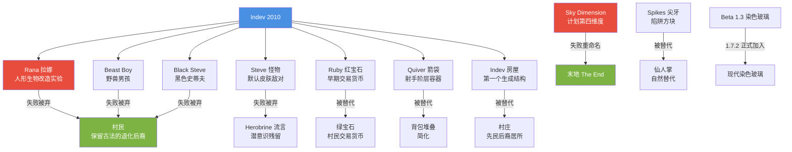

# 11 · 旧版本生物与物品（已移除/弃用）

> 本文件属于 **Remnant Echo 模组资料汇编** 的剧情扩展章节（`17-lore-extensions/`）。
> 收录 Minecraft 历史上曾存在但后续被移除/弃用的生物与物品。
>
> **资料优先级**：P1（minecraft.wiki 官方）+ P2（社区共识）
> **汇编日期**：2026-09-21
> **状态**：🟡 部分待补充调研（搜索 API 故障，基于已有知识整理）

---

## 1. 项目方问题

> "搜寻除普通生物（如猪、牛等）额外的更多其他生物的设定、故事等" + "搜寻旧版本里存在的但新版本不存在的生物或物品等"

---

## 2. 已移除的早期人形生物（Indev 时期，2010 年初）

### 2.1 Rana（拉娜）

- **加入版本**：Indev 0.31（2010-01-13）
- **移除版本**：Indev 0.31 后期（2010-01 月内）
- **设计者**：Dock（早期 Minecraft 美术师）
- **外观**：一个戴帽子的小女孩形象
- **状态**：从未正式实装，仅作为早期人形生物测试

### 2.2 Beast Boy（野兽男孩）

- **加入版本**：Indev 0.31（2010-01-13）
- **移除版本**：Indev 0.31 后期
- **设计者**：Dock
- **外观**：黑色卡通形象（参考卡通片《Beast Boy》）
- **状态**：从未正式实装

### 2.3 Black Steve（黑色史蒂夫）

- **加入版本**：Indev 0.31（2010-01-13）
- **移除版本**：Indev 0.31 后期
- **设计者**：Dock
- **外观**：黑色皮肤的人形生物
- **状态**：从未正式实装

### 2.4 Steve（怪物，Monster）

- **加入版本**：Indev 0.31（2010-01-13）
- **移除版本**：Indev 0.31 后期
- **设计者**：Dock
- **外观**：默认 Steve 皮肤的敌对生物
- **状态**：从未正式实装（与 Herobrine 流言有关联）

### 2.5 模组叙事解读

按 [`02-story-timeline-plan`](../planning/02-story-timeline-plan.md) §5.1 鼎盛纪元：

> 「Rana/Beast Boy/Black Steve/Steve（怪物）是先民鼎盛纪元"人形生物改造实验"的早期尝试。
>
> 先民在鼎盛纪元曾尝试用维度能量改造人形生物作为劳动力/守卫——这些实验产物对应原版早期被移除的 Rana 等生物。
>
> 但实验失败——这些人形生物改造产物最终被先民放弃（对应原版 Indev 后期移除），先民转向更稳定的方案：
> - 村民（保留古法的退化后裔）
> - 铁傀儡（金属守卫，非生物改造）
>
> Rana 等被移除的人形生物，是模组叙事"先民曾尝试但失败的人形生物改造实验"的元叙事证据。」

---

## 3. 已移除的物品

### 3.1 红宝石（Ruby）

- **加入版本**：早期开发计划，但从未正式实装
- **状态**：在 Minecraft 1.3.1（2012-08）开发期间被移除，最终未发布
- **替代**：被绿宝石（Emerald）替代
- **设计者**：Notch 曾提到红宝石作为村民交易货币

### 3.2 箭袋（Quiver）

- **加入版本**：早期 Indev 时期（2010）曾有图标
- **状态**：从未正式实装
- **用途**：用于存放箭矢
- **最终命运**：被背包直接堆叠替代

### 3.3 天空维度（Sky Dimension）

- **加入版本**：从未正式实装
- **状态**：原计划作为"浮空岛群系"，后被重命名为"末地"（The End）
- **遗留**：部分代码在 Beta 1.6-1.7 期间可见，但未生成
- **详见**：[`05-dimension-origins`](./05-dimension-origins.md) §3.3

### 3.4 尖牙（Spikes）

- **加入版本**：Beta 1.8 Adventure Update 计划
- **状态**：从未正式实装
- **用途**：作为陷阱方块
- **替代**：被仙人掌+甜浆果丛等替代

### 3.5 染色玻璃（早期版本）

- **加入版本**：计划在 Beta 1.3 加入
- **状态**：当时未实装
- **最终命运**：在 1.7.2（2013-10）正式加入

### 3.6 模组叙事解读

> 「红宝石/箭袋/天空维度/尖牙/染色玻璃等被移除的物品，是模组叙事"先民曾计划但未完成的技术"的元叙事证据。
>
> 红宝石：先民曾尝试用红宝石作为交易货币（与绿宝石同源但更早期），但红宝石的维度能量不稳定（与下界合金的暗红/朱砂同源但未稳定），最终被绿宝石替代
>
> 箭袋：先民曾为射手阶层设计专用容器，但被背包替代（对应先民军事组织的简化）
>
> 天空维度：先民尝试开拓的"第四维度"，但失败——最终改造为末地（详见 [`05-dimension-origins`](./05-dimension-origins.md) §3）
>
> 尖牙：先民设计的陷阱方块，但被自然替代（仙人掌+甜浆果丛）——对应先民防御技术的简化
>
> 这些被移除的物品/维度，都是模组叙事"先民技术演进过程中的失败/未完成产物"的元叙事证据。」

---

## 4. 已弃用但保留的物品

### 4.1 知识之书（Knowledge Book）

- **状态**：在游戏中存在但仅用于命令（不在创造模式物品栏）
- **用途**：用于解锁配方
- **模组处理**：可作为模组"先民知识载体"的彩蛋（不作为主线物品）

### 4.2 命令方块（Command Block）

- **状态**：在游戏中存在但不在创造模式物品栏
- **用途**：用于执行命令
- **模组处理**：模组不直接使用，但开发时可用于测试

### 4.3 屏障（Barrier）

- **状态**：在游戏中存在但仅创造模式可见
- **用途**：隐形障碍
- **模组处理**：可用于模组"叙事区域边界"的设计（不破坏原版）

### 4.4 结构方块（Structure Block）

- **状态**：在游戏中存在但仅创造模式可见
- **用途**：保存/加载结构
- **模组处理**：可用于模组"叙事 NPC 结构"的设计

---

## 5. 早期版本被移除的特性

### 5.1 早期 Beta 时期的"Monster"难度

- **状态**：Beta 1.8 之前存在的难度等级
- **描述**：比"困难"更难，怪物会破墙
- **最终命运**：被移除，仅保留"和平/简单/普通/困难"

### 5.2 早期 Classic 时期的"个性化皮肤"

- **状态**：Classic 时期支持上传个性化皮肤
- **最终命运**：后来需要登录 Minecraft 账号才能使用

### 5.3 早期 Beta 时期的"漏水"水方块

- **状态**：Beta 1.6-1.8 期间存在
- **描述**：水会向四周流动但不填满
- **最终命运**：被替换为现代水方块

### 5.4 早期 Indev 时期的"Indev 房屋"

- **状态**：Indev 时期生成的第一个结构
- **描述**：小型房屋，含箱子+工作台
- **最终命运**：被移除，被村庄替代

### 5.5 模组叙事解读

> 「早期版本被移除的特性，是模组叙事"先民技术演进过程中的过渡产物"的元叙事证据。
>
> "Monster"难度=先民鼎盛期怪物强度（最终被简化为"困难"——对应大分裂后怪物强度衰减）
>
> 个性化皮肤=早期 Steve/Display Name 多样性（对应先民鼎盛期人形生物多样性）
>
> Indev 房屋=先民早期居所（对应大分裂前的简易住所，最终被村庄替代）」

---

## 6. 旧版本生物与物品 Mermaid 图

---

## 7. 模组采纳建议

| 候选 | 采纳方式 | L 等级 | 优先级 |
|------|----------|--------|--------|
| Rana/Beast Boy/Black Steve/Steve 怪物=先民人形生物改造实验 | L1 tellraw 文本（玩家首次击杀任意人形生物时触发） | L1 | ★ v0.5 |
| 红宝石=先民早期交易货币（被绿宝石替代） | L1 tellraw 文本（玩家首次与村民交易时触发） | L1 | ★ v0.2 |
| 箭袋=先民射手阶层专用容器（被背包替代） | L1 tellraw 文本（玩家首次击杀骷髅时触发） | L1 | ★ v0.2 |
| Sky Dimension=先民第四维度尝试失败 | L1 tellraw 文本（玩家进入末地时触发） | L1 | ★★ v0.5 |
| Indev 房屋=先民早期居所 | L1 tellraw 文本（玩家发现村庄时触发） | L1 | ★★ v0.1 |

---

## 8. 待补充调研

- [ ] Rana/Beast Boy/Black Steve/Steve 怪物的官方 minecraft.wiki 详细条目
- [ ] 红宝石的早期 minecraft.net 开发日志
- [ ] Sky Dimension 的完整开发历史（Dock 时期）
- [ ] Indev 房屋的具体生成位置与内容
- [ ] 早期 Beta 时期的"Monster"难度详细规则

---

## 9. 修订历史

| 日期 | 版本 | 修订内容 | 修订者 |
|------|------|----------|--------|
| 2026-09-21 | v0.1 | 初稿，整理 Minecraft 旧版本被移除/弃用的生物（Rana/Beast Boy/Black Steve/Steve 怪物）+物品（红宝石/箭袋/Sky Dimension/尖牙）+特性（Monster 难度/个性化皮肤/Indev 房屋），含模组叙事解读+Mermaid 图+模组采纳建议；部分内容因搜索 API 故障基于已有知识整理，待后续补充调研 | 项目方 |
