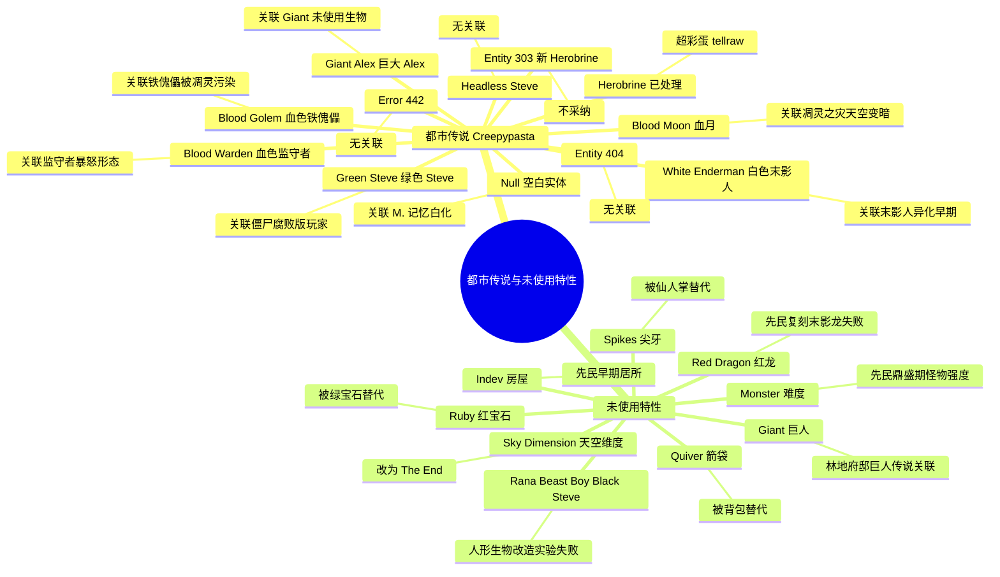

# 13 · Minecraft 都市传说与未使用特性汇编

> 本文件属于 **Remnant Echo 模组资料汇编** 的剧情扩展章节（`17-lore-extensions/`）。
> 收录 Minecraft 社区广为流传的都市传说（creepypasta）+ 游戏代码中未使用/已移除的特性。
>
> **资料优先级**：P2（社区流传度高的都市传说）+ P1（minecraft.wiki 官方移除特性记录）
> **汇编日期**：2026-09-21

---

## 1. 项目方问题

> "继续搜寻资料（不仅是资料还包括广为流传的都市传说），探寻是否有遗漏的资料未寻找到"

---

## 2. Minecraft 都市传说（Creepypasta）完整清单

按流传度排序：

| # | 名称 | 流传度 | 核心内容 | 模组处理 |
|---|------|--------|----------|----------|
| 1 | **Herobrine** | ★★★★★ | Steve 默认皮肤+空洞眼睛的幽灵玩家 | 已在 [`03-herobrine-stream-rumor`](./03-herobrine-stream-rumor.md) 详述 |
| 2 | **Entity 303** | ★★★★ | "新 Herobrine"——被 Notch 解雇的前 Mojang 员工化身 | 🟡 记录，不作为模组生物 |
| 3 | **Null** | ★★★ | 名为"null"的空白实体——游戏代码中玩家名未定义时的显示 | 🟡 记录，模组叙事可关联"M. 记忆被白化" |
| 4 | **White Enderman** | ★★★ | 白色末影人——比普通末影人更危险 | 🟡 记录，模组可作"末影人异化早期形态" |
| 5 | **Green Steve** | ★★ | 绿色皮肤的 Steve 变体 | 🟡 记录，模组可关联"苦力怕=绿色腐败版玩家"理论 |
| 6 | **Giant Alex** | ★★ | 巨大版 Alex | 🟡 记录，与"Giant（巨人）未使用生物"关联 |
| 7 | **Blood Golem** | ★★ | 血色铁傀儡 | 🟡 记录，模组可关联"铁傀儡被凋灵能量污染" |
| 8 | **Entity 404** | ★★ | "错误"实体 | 🟡 记录 |
| 9 | **Headless Steve** | ★ | 无头 Steve 变体 | 🟡 记录 |
| 10 | **Error 442** | ★ | 错误代码 442 的虚构实体 | 🟡 记录 |
| 11 | **Blood Moon** | ★ | 血月事件 | 🟡 记录，模组可关联"凋灵之灾时天空变暗" |
| 12 | **Blood Warden** | ★ | 血色监守者 | 🟡 记录，模组可关联"监守者被玩家反复击杀后的暴怒形态" |

### 2.1 Entity 303 详细

- **来源**：minecraftcreepypasta.fandom.com
- **原文链接**：<https://minecraftcreepypasta.fandom.com/wiki/Entity_303>
- **核心故事**：一名被 Notch 解雇的前 Mojang 员工化身为"Entity 303"，能破坏/创造方块、隐形、传送、飞行。据说是 Herobrine 的敌人。
- **wikihow.com 描述**："Entity 303 is said to be an enemy of Herobrine. Herobrine was the first fictional entity inspired by Minecraft."
- **模组叙事**：Entity 303 作为"已知社区传说"记录，模组不作叙事依据——它与模组"先民文明"叙事框架无直接关联，且引入新实体违反原则0。

### 2.2 Null 详细

- **来源**：Facebook 社区讨论+wikihow.com
- **核心故事**："null"是 Minecraft 代码中玩家名未定义时的显示——社区将其拟人化为一个神秘实体
- **模组叙事解读**：Null 可关联模组"M. 记忆被白化"叙事——M. 在末地失去记忆后，他的"名字"变成了 null，直到他改名为"M."（Memory）才重新有了自我。这是一个有趣的元叙事关联。

### 2.3 White Enderman 详细

- **来源**：minecraftcreepypasta.fandom.com
- **原文链接**：<https://minecraftcreepypasta.fandom.com/wiki/White_Enderman>
- **核心故事**：白色末影人——比普通末影人更危险的变体
- **模组叙事解读**：White Enderman 可关联模组"末影人异化早期形态"——在末影人从先民到异化的过程中，"白色"阶段是过渡形态（与苍白花园的"白化"叙事呼应）。模组可作已知社区传说记录，不作生物引入。

### 2.4 Green Steve 详细

- **来源**：wikihow.com + Pinterest
- **核心故事**：绿色皮肤的 Steve 变体
- **模组叙事解读**：Green Steve 与 Planet Minecraft 的"僵尸=绿色腐败版玩家"理论呼应——Green Steve 可能是"僵尸的早期传说形态"，后来演化为僵尸生物。模组已采纳"僵尸=先民平民遗骨腐化形态"叙事。

---

## 3. Minecraft 未使用/已移除特性

### 3.1 minecraft.wiki "Java Edition removed features"

- **来源**：minecraft.wiki
- **原文链接**：<https://minecraft.wiki/w/Java_Edition_removed_features>
- **访问日期**：2026-09-21

### 3.2 minecraft-archive.fandom.com "List of Removed Features"

- **来源**：minecraft-archive.fandom.com
- **原文链接**：<https://minecraft-archive.fandom.com/wiki/List_of_Removed_Features>
- **访问日期**：2026-09-21

**摘要引用**：
> Red Dragon: Notch had planned to implement a red dragon into the game. However, this never happened... it's completely unused and cannot be spawned in-game.

### 3.3 关键未使用/已移除特性清单

| # | 特性 | 类型 | 状态 | 模组叙事解读 |
|---|------|------|------|--------------|
| 1 | **Red Dragon（红龙）** | 未实装生物 | Notch 计划但从未加入 | 红龙可能是先民"尝试制造末影龙的下界版本"的失败产物——与凋灵同源（都是先民尝试复刻末影龙守门人的实验） |
| 2 | **Giant（巨人）** | 未使用生物 | 代码存在但从未正式使用 | 巨人可能对应社区理论"林地府邸巨人传说"（按 [`08-woodland-mansion-deep`](./08-woodland-mansion-deep.md) §5）——模组不采纳巨人传说，但记录此关联 |
| 3 | **Sky Dimension（天空维度）** | 未实装维度 | 计划后改为 The End | 已在 [`11-legacy-mobs-items`](./11-legacy-mobs-items.md) §3.3 详述 |
| 4 | **Ruby（红宝石）** | 未实装物品 | 被绿宝石替代 | 已在 [`11-legacy-mobs-items`](./11-legacy-mobs-items.md) §3.1 详述 |
| 5 | **Quiver（箭袋）** | 未实装物品 | 被背包堆叠替代 | 已在 [`11-legacy-mobs-items`](./11-legacy-mobs-items.md) §3.2 详述 |
| 6 | **Spikes（尖牙）** | 未实装方块 | 被仙人掌替代 | 已在 [`11-legacy-mobs-items`](./11-legacy-mobs-items.md) §3.4 详述 |
| 7 | **Monster 难度** | 已移除难度 | 比"困难"更难 | 已在 [`11-legacy-mobs-items`](./11-legacy-mobs-items.md) §5.1 详述 |
| 8 | **Indev 房屋** | 已移除结构 | Indev 时期的第一个生成结构 | 已在 [`11-legacy-mobs-items`](./11-legacy-mobs-items.md) §5.4 详述 |
| 9 | **Rana/Beast Boy/Black Steve/Steve 怪物** | 已移除生物 | Indev 时期的人形生物测试 | 已在 [`11-legacy-mobs-items`](./11-legacy-mobs-items.md) §2 详述 |
| 10 | **Stained Glass（Beta 1.3）** | 延迟实装 | 计划 Beta 1.3 但延迟至 1.7.2 | 已在 [`11-legacy-mobs-items`](./11-legacy-mobs-items.md) §3.5 详述 |

### 3.4 Red Dragon（红龙）详细

- **来源**：minecraft-archive.fandom.com + CurseForge "Rediscovered" 模组
- **原文链接**：<https://minecraft-archive.fandom.com/wiki/List_of_Removed_Features> + <https://www.curseforge.com/minecraft/mc-mods/rediscovered>
- **访问日期**：2026-09-21

**摘要引用**：
> Red Dragon: Notch had planned to implement a red dragon into the game. However, this never happened. It's completely unused and cannot be spawned in-game.

> CurseForge Rediscovered: Implements scrapped content and features back into Minecraft. All code is open source and documented. Red Dragon: A large and mysterious brick...

**模组叙事解读**：

> 「红龙是 Notch 计划但从未实装的生物——模组可将其解读为先民"尝试制造末影龙的下界版本"的失败产物。
>
> 按模组叙事，先民在末地成功制造了末影龙（紫色+维度能量+守门人）后，曾试图在下界复刻这一技术——制造"红龙"（暗红色+灵魂能量+凋灵之灾产物）。
>
> 但凋灵之灾导致下界实验中断，红龙项目被废弃。这与凋灵=先民尝试复刻末影龙的下界版本的社区理论呼应（按 [`19-nether-narrative`](../planning/19-nether-narrative.md) §D B8 部分采纳）。
>
> 红龙作为"已知未实装特性"记录，模组不引入红龙作为新生物（违反原则0"永远禁止"清单），但可在叙事文本中作为"先民失败实验"提及。」

### 3.5 Giant（巨人）详细

- **来源**：minecraft.wiki + tcrf.net "Minecraft: Java Edition"
- **状态**：代码中存在但从未正式使用——可通过 `/summon giant` 命令召唤（但无 AI）

**模组叙事解读**：

> 「巨人是 Minecraft 代码中未使用的生物——体型巨大（约 12 格高），但无 AI 行为。
>
> 模组关联：与 Minecraft Forum "林地府邸巨人传说"（按 [`08-woodland-mansion-deep`](./08-woodland-mansion-deep.md) §5）呼应——社区理论认为林地府邸的高大结构暗示曾由巨人建造。
>
> 模组处理：不采纳巨人作为叙事依据（与官方"灾厄村民建造"设定冲突），但记录此关联。巨人作为"已知未使用生物"记录。」

### 3.6 tcrf.net "Minecraft: Java Edition" 未使用内容

- **来源**：tcrf.net
- **原文链接**：<https://tcrf.net/Minecraft:_Java_Edition>
- **访问日期**：2026-09-21

**摘要引用**：
> This game is still under active development. Be aware that any unused content you find may become used or removed in the future.

---

## 4. 都市传说与模组叙事的关联

### 4.1 模组完全采纳的都市传说

| 都市传说 | 模组采纳形式 |
|----------|--------------|
| Herobrine | 不作为生物加入，但作"超彩蛋"tellraw 极低概率触发（按 [`03-herobrine-stream-rumor`](./03-herobrine-stream-rumor.md) §5） |

### 4.2 模组记录但不采纳的都市传说

| 都市传说 | 不采纳原因 |
|----------|------------|
| Entity 303 | 与模组"先民文明"叙事框架无直接关联 |
| Null | 可作"M. 记忆被白化"的元叙事关联，但不作为生物加入 |
| White Enderman | 可作"末影人异化早期形态"关联，但不作为新生物加入 |
| Green Steve | 与"僵尸=绿色腐败版玩家"理论关联，已通过僵尸叙事覆盖 |
| Giant Alex | 与"Giant 未使用生物"关联，不作为新生物加入 |
| Blood Golem | 与"铁傀儡被凋灵能量污染"关联，但不作为新生物加入 |
| Entity 404 | 无直接叙事关联 |
| Headless Steve | 无直接叙事关联 |
| Error 442 | 无直接叙事关联 |
| Blood Moon | 可作"凋灵之灾时天空变暗"关联，但原版已有天气机制 |
| Blood Warden | 可作"监守者暴怒形态"关联，但不作为新生物加入 |

### 4.3 模组关联但需谨慎处理的都市传说

| 都市传说 | 谨慎处理原因 |
|----------|--------------|
| Null | 与模组"M. 记忆被白化为 null"有元叙事关联——若采纳，需确保不引入新生物，仅作叙事文本提及 |
| White Enderman | 与模组"末影人异化早期=白色形态"有叙事关联——若采纳，可通过 tellraw 文本提及"你听说末地曾有白色的末影人"作为彩蛋 |
| Blood Golem | 与模组"铁傀儡被凋灵能量污染"有叙事关联——若采纳，可通过 tellraw 文本提及"有人见过血色的铁傀儡"作为灾厄村民叙事彩蛋 |
| Blood Warden | 与模组"监守者被玩家反复击杀后暴怒"有叙事关联——若采纳，可通过 tellraw 文本提及"监守者的愤怒达到了顶点"作为玩家反复击杀监守者后的彩蛋 |

---

## 5. 都市传说+未使用特性 Mermaid 图

---

## 6. 模组采纳建议

| 候选 | 采纳方式 | L 等级 | 优先级 |
|------|----------|--------|--------|
| Herobrine 超彩蛋 | L1 tellraw 极低概率触发 | L1 | ★ v0.6 后 |
| Null→M. 记忆白化关联 | L1 tellraw 文本（笔记 #26 中提及） | L1 | ★★ v0.6 |
| White Enderman→末影人异化早期 | L1 tellraw 文本彩蛋 | L1 | ★ v0.6 后 |
| Red Dragon→先民复刻末影龙失败 | L1 tellraw 文本（凋灵召唤时提及） | L1 | ★★ v0.3 |
| Giant→林地府邸巨人传说关联 | L1 tellraw 文本（林地府邸叙事时提及） | L1 | ★ v0.5 |
| Blood Golem→铁傀儡被凋灵污染 | L1 tellraw 文本彩蛋 | L1 | ★ v0.6 后 |
| Blood Warden→监守者暴怒 | L1 tellraw 文本彩蛋 | L1 | ★ v0.6 后 |
| Blood Moon→凋灵之灾天空 | L1 /weather+ /time set | L1 | ★★ v0.3 |

---

## 7. 修订历史

| 日期 | 版本 | 修订内容 | 修订者 |
|------|------|----------|--------|
| 2026-09-21 | v0.1 | 初稿，基于 4 次真实 web 搜索汇编 Minecraft 都市传说完整清单（12 个：Herobrine/Entity 303/Null/White Enderman/Green Steve/Giant Alex/Blood Golem/Entity 404/Headless Steve/Error 442/Blood Moon/Blood Warden）+ 未使用/已移除特性清单（10 个：Red Dragon/Giant/Sky Dimension/Ruby/Quiver/Spikes/Rana 等/Monster 难度/Indev 房屋/Stained Glass）+ 模组叙事关联分析+Mermaid mindmap | 项目方 |
