# 14 · Minecraft 全版本生物历史完整汇编

> 本文件属于 **Remnant Echo 模组资料汇编** 的剧情扩展章节（`17-lore-extensions/`）。
> 按项目方 2026-09-21 指示"分解 minecraft 所有历史版本对历史所有生物进行资料搜寻与总结"
>
> **资料优先级**：P1（minecraft.wiki 官方+minecraft.net）
> **汇编日期**：2026-09-21

---

## 1. 目的

将 Minecraft 从 2009 年第一个生物（僵尸）到 2026 年最新版本的所有生物按版本逐一列出，形成完整的"生物历史时间轴"。

**资料来源**：
- minecraft.wiki "List of mobs by version"（<https://minecraft.wiki/w/List_of_mobs_by_version>）
- minecraft.wiki "Java Edition mob render history"
- minecraft.net "Updates Timeline and Game Evolution"
- mcmobs.fandom.com "Update Versions"

---

## 2. 全版本生物历史（2009-2026）

### 2.1 Classic 时期（2009）

| 版本 | 日期 | 新增生物 | 类型 | 模组叙事关联 |
|------|------|----------|------|--------------|
| pre-Classic rd-132211 | 2009-05-10 | **僵尸（Zombie）** | 敌对 | Minecraft 历史上第一个生物；模组=先民平民遗骨腐化 |
| Classic 0.24 survival test | 2009-08-24 | **苦力怕（Creeper）** | 敌对 | Notch 编程错误；模组=生命本源研究副产物 |
| Classic 0.24 | 2009-08-24 | **骷髅（Skeleton）** | 敌对 | 模组=先民射手阶层遗骨 |
| Classic 0.27 | 2009-09-03 | **猪（Pig）/羊（Sheep）/牛（Cow）/鸡（Chicken）** | 被动 | 模组=非人形生物（猪=苦力怕同源） |

### 2.2 Indev 时期（2010）

| 版本 | 日期 | 新增/移除生物 | 类型 | 模组叙事关联 |
|------|------|----------|------|--------------|
| Indev 0.31 | 2010-01-13 | **Rana/Beast Boy/Black Steve/Steve（怪物）** | 敌对 | 模组=先民人形生物改造实验失败产物（后被移除） |
| Indev 0.31 | 2010-01 | **史莱姆（Slime）** | 敌对 | 模组=维度能量残留的液态聚合体 |

### 2.3 Alpha 时期（2010）

| 版本 | 日期 | 新增生物 | 类型 | 模组叙事关联 |
|------|------|----------|------|--------------|
| Alpha 1.0.4 | 2010-07-09 | **蜘蛛（Spider）** | 中立 | 模组=主世界原生非人形生物 |
| Alpha 1.0.17 | 2010-08-18 | **末影人（Enderman）** | 中立 | 模组=末地殖民军异化后裔（核心角色） |
| Alpha 1.2.0 Halloween | 2010-10-30 | **恶魂（Ghast）/僵尸猪人（Zombie Pigman）** | 敌对/中立 | 模组=善魂被凋灵污染/猪灵的不死形态 |

### 2.4 Beta 时期（2010-2011）

| 版本 | 日期 | 新增生物 | 类型 | 模组叙事关联 |
|------|------|----------|------|--------------|
| Beta 1.2 | 2011-01-13 | **墨鱼（Squid）/狼（Wolf）** | 被动/中立 | 模组=水下生物+驯化力量具象 |
| Beta 1.4 | 2011-03-31 | **蜘蛛骑手（Spider Jockey）** | 组合 | 模组=先民射手+坐骑退化配对 |
| Beta 1.5 | 2011-04-19 | **豹猫（Ocelot）** | 中立 | 模组=驯化力量具象（可驯化为猫） |
| Beta 1.6 | 2011-05-26 | **洞穴蜘蛛（Cave Spider）** | 敌对 | 模组=先民实验室改造产物（毒元素） |
| Beta 1.8 Adventure | 2011-09-09 | **末影龙（Ender Dragon）/雪傀儡（Snow Golem）/村民（Villager）** | Boss/被动/中立 | 模组=守门人/先民后裔/先民后裔 |

### 2.5 正式版早期（2011-2016）

| 版本 | 日期 | 新增生物 | 类型 | 模组叙事关联 |
|------|------|----------|------|--------------|
| 1.0 正式版 | 2011-11-18 | （末影龙/末影人/雪傀儡/村民正式加入） | — | — |
| 1.2 | 2012-03-01 | **岩浆怪（Magma Cube）/哞菇（Mooshroom）** | 敌对/被动 | 模组=液态下界合金生命/生命本源研究产物 |
| 1.4 Pretty Scary | 2012-10-25 | **凋灵骷髅（Wither Skeleton）/女巫（Witch）/蝙蝠（Bat）** | 敌对/敌对/被动 | 模组=凋灵之灾产物/灾厄村民分支/无特殊叙事 |
| 1.6 Horse | 2013-07-01 | **马（Horse）/驴（Donkey）/骡（Mule）/骷髅马（Skeleton Horse）** | 被动/被动/被动/敌对 | 模组=先民驯化的坐骑+遗骨配对 |
| 1.8 Bountiful | 2014-09-02 | **守卫者（Guardian）/远古守卫者（Elder Guardian）/兔子（Rabbit）** | 敌对/敌对/被动 | 模组=先民水下分支防御机械/先民驯化生物 |
| 1.9 Combat | 2016-02-29 | **潜影贝（Shulker）** | 敌对 | 模组=末地城防御机械 |

### 2.6 现代时期（2016-2026）

| 版本 | 日期 | 新增生物 | 类型 | 模组叙事关联 |
|------|------|----------|------|--------------|
| 1.10 Frostburn | 2016-06-08 | **北极熊（Polar Bear）/尸壳（Husk）/流髑（Stray）** | 中立/敌对/敌对 | 模组=冰系生物/僵尸沙漠变种/骷髅雪原变种 |
| 1.11 Exploration | 2016-12-12 | **掠夺者（Pillager）/卫道士（Vindicator）/唤魔者（Evoker）/劫掠兽（Ravager）/恼鬼（Vex）/羊驼（Llama）** | 敌对/敌对/敌对/敌对/敌对/中立 | 模组=灾厄村民家族五人组+驯化生物 |
| 1.13 Update Aquatic | 2018-07-18 | **海豚（Dolphin）/海龟（Turtle）/鳕鱼/鲑鱼/河豚/热带鱼/溺尸（Drowned）/幻术师（Illusioner，未实装）** | 中立/被动/被动×4/敌对/敌对 | 模组=水下研究站导航员/先民驯化/水生生物/维度诅咒水下形态 |
| 1.14 Village & Pillage | 2019-04-23 | **熊猫（Panda）/狐狸（Fox）** | 被动/中立 | 模组=生命本源研究温和产物/驯化力量 |
| 1.15 Buzzy Bees | 2019-12-17 | **蜜蜂（Bee）** | 被动 | 模组=生命本源研究温和产物（攻击后死亡=能量不稳定） |
| 1.16 Nether Update | 2020-06-23 | **猪灵（Piglin）/猪灵蛮兵（Piglin Brute）/疣猪兽（Hoglin）/疣猪兽僵尸（Zoglin）/炽足兽（Strider）** | 中立/敌对/敌对/敌对/中立 | 模组=先民下界分支后裔/守卫阶层/驯化食物/诅咒形态/驯化坐骑 |
| 1.17 Caves & Cliffs I | 2021-06-08 | **美西螈（Axolotl）/山羊（Goat）/发光鱿鱼（Glow Squid）** | 被动/被动/被动 | 模组=先民水下研究副产物/驯化生物/维度能量发光形态 |
| 1.19 The Wild | 2022-06-07 | **监守者（Warden）/青蛙（Frog）/蝌蚪（Tadpole）/悦灵（Allay）** | Boss/被动/被动/被动 | 模组=科研贵族灵魂聚合/生命本源产物/蝌蚪阶段/维度能量残留飞行 |
| 1.20 Trails & Tales | 2023-06-07 | **嗅探兽（Sniffer）/骆驼（Camel）** | 被动/被动 | 模组=先民遗留的"古老生物"（从蛋中孵化）/沙漠驯化坐骑 |
| 1.21 Tricky Trials | 2024-06-13 | **旋风人（Breeze）/沼骸（Bogged）** | 敌对/敌对 | 模组=风元素维度能量残留/骷髅湿地变种（毒元素） |
| 1.21.9 Copper Age | 2025-09-30 | **铜傀儡（Copper Golem）** | 中立 | 模组=先民守卫早期实验（四色光谱+第五色铜绿） |
| 1.21.11 | 2025-10-29+ | **鹦鹉螺（Nautilus）/僵尸鹦鹉螺（Zombie Nautilus）/骆驼尸壳（Camel Husk）/焦骸（Parched）** | 中立/敌对/被动不死/敌对 | 模组=水下生物+维度诅咒/沙漠不死变体/骷髅沙漠变种（虚弱元素） |
| 26.1 Tiny Takeover | 2026-09 | **金蒲公英（Golden Dandelion，物品非生物）** | — | 模组=生命本源研究残留 |
| 26.2 Chaos Cubed | 2026-06-16 | **硫磺立方体（Sulfur Cube）** | 敌对 | 模组=先民工业研究遗址的维度能量残留 |
| 26.3 Wilderness Bound | 2026-09-15 | （无新生物） | — | 帐篷+干草床+废弃营地 |
| Minecraft Live 2026 9月 | 2026-09 | **新僵尸变种+Ice Caves 群系** | 敌对 | 模组=僵尸在 Ice Caves 的冰化演化（预解读） |

---

## 3. 全版本生物统计

| 时期 | 版本范围 | 新增生物数 | 累计生物数 |
|------|----------|------------|------------|
| Classic | 2009 | 7 | 7 |
| Indev | 2010 | 5（含移除 4） | 8（移除 4 后） |
| Alpha | 2010 | 4 | 12 |
| Beta | 2010-2011 | 8 | 20 |
| 1.0-1.4 | 2011-2012 | 8 | 28 |
| 1.6-1.9 | 2013-2016 | 8 | 36 |
| 1.10-1.11 | 2016 | 9 | 45 |
| 1.13-1.15 | 2018-2019 | 12 | 57 |
| 1.16 | 2020 | 5 | 62 |
| 1.17-1.19 | 2021-2022 | 9 | 71 |
| 1.20-1.21 | 2023-2024 | 4 | 75 |
| 1.21.9-1.21.11 | 2025 | 5 | 80 |
| 26.1-26.3+Live 2026 | 2026 | 2+ | 82+ |

---

## 4. 移除/未使用生物完整清单

| 生物 | 状态 | 移除/未使用原因 | 模组叙事关联 |
|------|------|-----------------|--------------|
| Rana | Indev 移除 | Dock 离开后移除 | 先民人形生物改造实验失败产物 |
| Beast Boy | Indev 移除 | 同上 | 同上 |
| Black Steve | Indev 移除 | 同上 | 同上 |
| Steve（怪物） | Indev 移除 | 同上 | 与 Herobrine 流言关联 |
| **Giant（巨人）** | 代码未使用 | 无 AI，从未正式使用 | 与林地府邸巨人传说关联 |
| **Red Dragon（红龙）** | 未实装 | Notch 计划但从未加入 | 先民复刻末影龙下界版本的失败产物 |
| **幻术师（Illusioner）** | 代码未使用 | 1.13 设计但未正式实装 | 灾厄村民分支的"幻术研究者"彩蛋 |

---

## 5. 全版本生物 Mermaid 时间线

```mermaid
timeline
    title Minecraft 全版本生物历史（2009-2026）
    section 2009 Classic
        2009-05 : 僵尸（第一个生物）
        2009-08 : 苦力怕 / 骷髅
        2009-09 : 猪 / 羊 / 牛 / 鸡
    section 2010 Indev-Alpha
        2010-01 : Rana 等4种（后移除） / 史莱姆
        2010-07 : 蜘蛛
        2010-08 : 末影人
        2010-10 : 恶魂 / 僵尸猪人
    section 2011 Beta
        2011-01 : 墨鱼 / 狼
        2011-03 : 蜘蛛骑手 / 豹猫
        2011-05 : 洞穴蜘蛛
        2011-09 : 末影龙 / 雪傀儡 / 村民
    section 2012-2016
        2012-03 : 岩浆怪 / 哞菇
        2012-10 : 凋灵骷髅 / 女巫 / 蝙蝠
        2013-07 : 马 / 驴 / 骡 / 骷髅马
        2014-09 : 守卫者 / 远古守卫者 / 兔子
        2016-02 : 潜影贝
    section 2016-2019
        2016-06 : 北极熊 / 尸壳 / 流髑
        2016-12 : 灾厄村民5种 / 羊驼
        2018-07 : 海豚 / 海龟 / 鱼 / 溺尸
        2019-04 : 熊猫 / 狐狸
        2019-12 : 蜜蜂
    section 2020-2026
        2020-06 : 猪灵 / 猪灵蛮兵 / 疣猪兽 / 疣猪兽僵尸 / 炽足兽
        2021-06 : 美西螈 / 山羊 / 发光鱿鱼
        2022-06 : 监守者 / 青蛙 / 蝌蚪 / 悦灵
        2023-06 : 嗅探兽 / 骆驼
        2024-06 : 旋风人 / 沼骸
        2025-09 : 铜傀儡
        2025-10 : 鹦鹉螺 / 僵尸鹦鹉螺 / 骆驼尸壳 / 焦骸
        2026-06 : 硫磺立方体
        2026-09 : 新僵尸变种 + Ice Caves
```

---

## 6. 模组叙事关联分析

### 6.1 按模组六大纪元对应

| 模组纪元 | 对应 Minecraft 版本 | 关键生物 |
|----------|---------------------|----------|
| 鼎盛纪元 | Classic-Beta（2009-2011） | 僵尸/苦力怕/骷髅/猪/末影人/末影龙/村民 |
| 凋灵之灾 | 1.2-1.4（2012） | 僵尸猪人/岩浆怪/凋灵骷髅/女巫 |
| 幽匿之厄 | 1.19（2022） | 监守者/青蛙/蝌蚪/悦灵 |
| 苍白之悔 | 1.21.50+（2024+） | 嘎枝/苍白橡木 |
| 大分裂 | 1.10-1.16（2016-2020） | 灾厄村民/猪灵/北极熊/尸壳/流髑 |
| 现代纪元 | 1.17+（2021+） | 美西螈/山羊/发光鱿鱼/嗅探兽/骆驼/铜傀儡/焦骸 |

### 6.2 按模组四色光谱对应

| 颜色 | 研究领域 | 对应生物 |
|------|----------|----------|
| 暗红 | 维度穿行 | 恶魂/凋灵骷髅/烈焰人/岩浆怪 |
| 紫 | 维度异化 | 末影人/末影龙/潜影贝/终界螨 |
| 白 | 生命本源 | 嘎枝/蜜蜂/美西螈 |
| 蓝 | 灵魂能量 | 监守者/骷髅/僵尸/女巫 |
| 铜绿 | 铜器工艺 | 铜傀儡/铁傀儡 |
| 筛色（待定） | The Sift | 待 v0.6+ 后确定 |

---

## 7. 修订历史

| 日期 | 版本 | 修订内容 | 修订者 |
|------|------|----------|--------|
| 2026-09-21 | v0.1 | 初稿，基于 4 次真实 web 搜索（minecraft.wiki List of mobs by version+mob render history+removed features+mcmobs.fandom Update Versions），整理 Minecraft 2009-2026 全版本生物历史（82+ 种生物）+移除/未使用生物清单（7 种）+全版本生物统计+Mermaid 时间线+模组叙事关联分析 | 项目方 |
