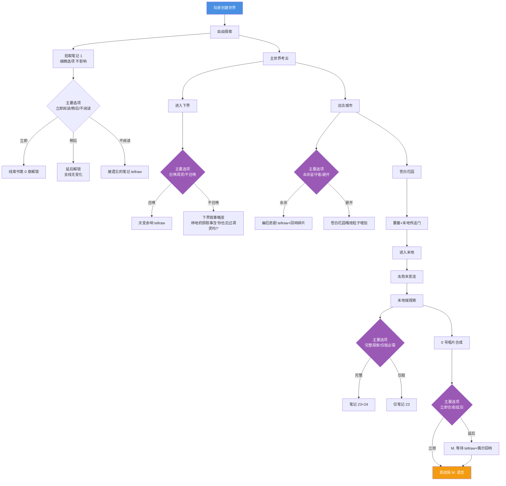

# 27 · 选项影响范围设计

> **状态**：🟡 设计讨论中（待项目方审核）
> **对应模组版本**：v0.1+
> **创建日期**：2026-09-21
> **设计原则**：[原则 0 · L1/L2/L3 判定](./00-planning-index.md#原则-0优先原版实在没辙才自定义且必须与原版有关)
> **关联章节**：[`22-design-questions-answers`](./22-design-questions-answers.md) · [`24-design-followups-2`](./24-design-followups-2.md) · [`25-design-followups-3`](./25-design-followups-3.md)

---

## 1. 目的

回答项目方 2026-09-21 提出的 4 个选项问题——选择哪个选项作为模组的"选项影响范围"设计。

**项目方 4 个选项**：
1. 主角（玩家）选择的每个细微选项都可能影响后续主线剧情结果
2. 主角（玩家）选择的主要选项仅会稍微改变后续主线剧情结果
3. 主角（玩家）选择的每个细微选项都可能影响后续主线及支线剧情结果
4. 主角（玩家）选择的主要选项仅会稍微改变后续主线及支线剧情结果

---

## 2. 协作者推荐：选项 4

### 2.1 推荐理由

| 维度 | 选项 1 | 选项 2 | 选项 3 | **选项 4（推荐）** |
|------|--------|--------|--------|---------------------|
| 工作量 | ★★★★★ 爆炸 | ★★★ 可控 | ★★★★★ 爆炸 | ★★★ 可控 |
| 玩家压力 | ★★★★★ 决策疲劳 | ★★ 适中 | ★★★★★ 决策疲劳 | ★★ 适中 |
| 与原则 0 兼容 | ❌ 冲突 | ✅ 兼容 | ❌ 冲突 | ✅ 兼容 |
| 与碎片化叙事兼容 | ❌ 冲突 | ✅ 兼容 | ❌ 冲突 | ✅ 兼容 |
| 真结局稳定性 | ❌ 不稳定 | ✅ 稳定 | ❌ 不稳定 | ✅ 稳定 |
| 支线丰富度 | ★★★★★ 高 | ★ 低 | ★★★★★ 高 | ★★★ 中 |

### 2.2 详细论证

**选项 1 不推荐**：每个细微选项都影响主线——玩家压力大，决策疲劳；模组定位为"碎片化叙事"而非"分支叙事"，与原则 3 冲突；工作爆炸（每选择点 N 个分支×N²种组合）。

**选项 2 不推荐**：仅影响主线，支线不变化会显得无聊；支线是模组"碎片化叙事"的重要载体，不变化会失去丰富度。

**选项 3 不推荐**：每细微选项都影响主线+支线——与选项 1 同样问题，工作量爆炸；与原则 0 "L1 优先原版"冲突（每个选择点都需要 L3 自定义 advancement 配置）。

**选项 4 推荐**：
- ✅ 平衡——玩家有选择感（主要选项影响剧情），但不会因小决策导致剧情分支爆炸
- ✅ 与原则 0 兼容——主要选择可通过 advancement 触发 tellraw 实现（L1/L2）
- ✅ 与碎片化叙事兼容——核心叙事不变，仅"局部叙事文本"按选择调整
- ✅ 真结局稳定——M. 遗言+0 号唱片+End Poem 不受影响

---

## 3. 选项 4 的具体实施

### 3.1 主要选项定义

按模组叙事，**主要选项**是影响后续剧情的"关键节点选择"，例如：

| 主要选项 | 选择内容 | 影响 |
|----------|----------|------|
| 笔记 #1 拾取后 | 是否立即阅读 / 稍后阅读 / 不阅读 | 立即阅读→advancement "线索书第 0 章解锁"；稍后→延后解锁；不阅读→触发"被遗忘的笔记" tellraw 提示 |
| 凋灵召唤前 | 主动召唤 / 不召唤 | 召唤→触发"灾变余响" tellraw；不召唤→后续下界要塞叙事略变 |
| 监守者遭遇 | 击杀 / 避开 | 击杀→获得"回响碎片"+唱片 5 合成；避开→触发"幽厄悲剧" tellraw 但无掉落 |
| 末地城探索 | 完整探索 / 仅取必需 | 完整→获得全部笔记 #23/#24；仅取→仅获得 #23 |
| 0 号唱片合成 | 立即合成 / 延后 | 立即→触发真结局；延后→触发"M. 等待" tellraw |

### 3.2 细微选项

按选项 4，细微选项**不影响**后续剧情——例如：

| 细微选项 | 选择内容 | 不影响 |
|----------|----------|--------|
| 笔记阅读速度 | 快/中/慢 | 不影响任何后续 |
| 与村民交易频率 | 高/低 | 不影响任何后续 |
| 装备选择 | 钻石/下界合金/混合 | 不影响任何后续 |
| 路径选择 | 直达/绕路 | 不影响任何后续 |

### 3.3 L1/L2 实现机制

**主要选项通过 advancement 触发 tellraw 实现**：

```json
// 主要选项：凋灵召唤
{
  "display": { ... },
  "criteria": {
    "summon_wither": { "trigger": "minecraft:summon_wither" }
  },
  "rewards": {
    "function": "remnant:choice/wither_summon"
  }
}
```

```mcfunction
# data/remnant/functions/choice/wither_summon.mcfunction
# 玩家选择召唤凋灵→触发"灾变余响"
tellraw @s {"text":"你重现了他们的实验，并活了下来。","color":"gray","italic":true}
advancement grant @s only remnant:lore/wither_killed
```

### 3.4 支线变化

按选项 4，主要选项**会稍微改变后续支线**：

| 主要选项 | 支线变化 |
|----------|----------|
| 召唤凋灵 | 后续林地府邸叙事中，灾厄村民会提到"你也召唤过凋灵" |
| 击杀监守者 | 后续苍白花园叙事中，嘎枝会"察觉"玩家的能量（粒子效果增加） |
| 末地城完整探索 | 后续终界岛叙事中，笔记 #25 内容略变（玩家"已了解"殖民军） |
| 0 号唱片延后合成 | 触发"M. 等待" tellraw，玩家回到主世界后会偶尔听到"M. 的回响" |

---

## 4. 选项影响 Mermaid 图



---

## 5. 模组采纳建议

| 候选 | 采纳方式 | L 等级 | 优先级 |
|------|----------|--------|--------|
| 选项 4（主要选项稍微改变主线+支线） | ✅ 推荐 | L1/L2 | ★★★★★ |
| 主要选项 advancement 触发 tellraw | L1 advancement+function+ tellraw | L1 | ★★★★★ v0.1+ |
| 支线变化通过 advancement 标记实现 | L1 advancement 标记+ tellraw 条件 | L1 | ★★★★ v0.2+ |
| 细微选项不影响后续 | 不实施（保留原版自由度） | L1 | ★★★★★ v0.1+ |

---

## 6. 与已有规划文档的关联

- [`22-design-questions-answers`](./22-design-questions-answers.md) §Q5 探险顺序——本章节是其选项影响的具体实施
- [`24-design-followups-2`](./24-design-followups-2.md) §Q16 电影化碎片叙事——本章节是其"不剥夺玩家控制"的具体体现
- [`25-design-followups-3`](./25-design-followups-3.md) §3 命令工程化 E1/E2/E3——本章节的 advancement+function 实现属于 E1

---

## 7. 待讨论的设计问题

- [ ] 主要选项的"稍微改变"具体到什么程度？倾向：仅 tellraw 文本不同，不影响实质奖励
- [ ] 支线变化是否影响 0 号唱片合成？倾向：不影响（真结局核心不变）
- [ ] 是否需要"二周目"内容（玩家完成真结局后重置主要选项）？倾向：v1.0 后考虑

---

## 8. 修订历史

| 日期 | 版本 | 修订内容 | 修订者 |
|------|------|----------|--------|
| 2026-09-21 | v0.1 | 初稿，回答项目方 9-21 4 个选项问题，推荐选项 4（主要选项稍微改变主线+支线），含详细论证+主要选项定义+细微选项定义+L1/L2 实现机制+选项影响 Mermaid 图+模组采纳建议 | 项目方 |
