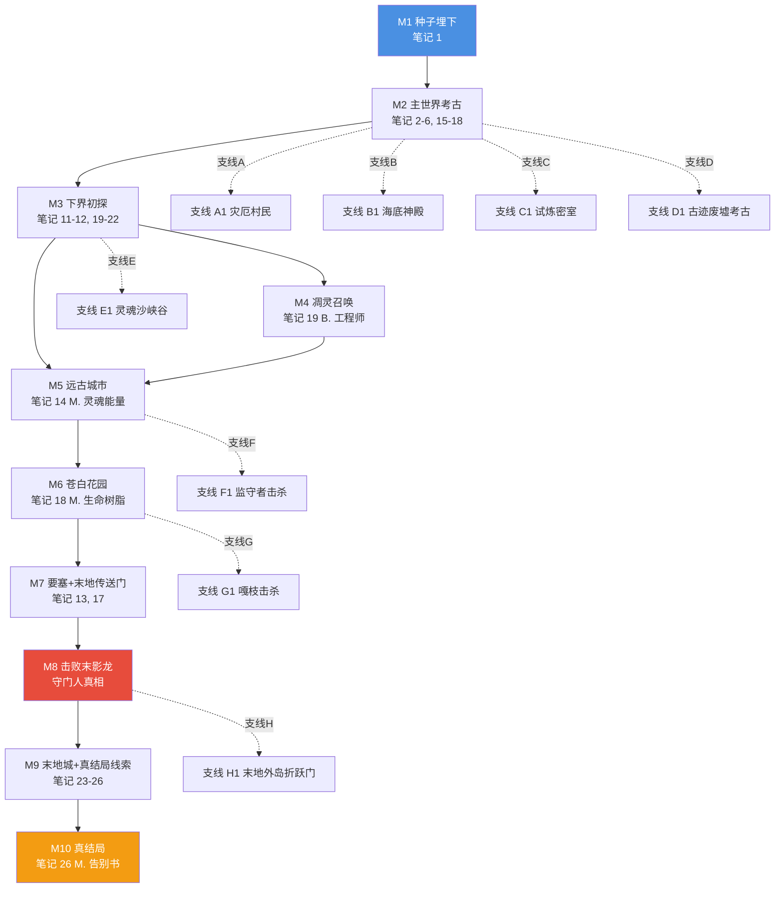
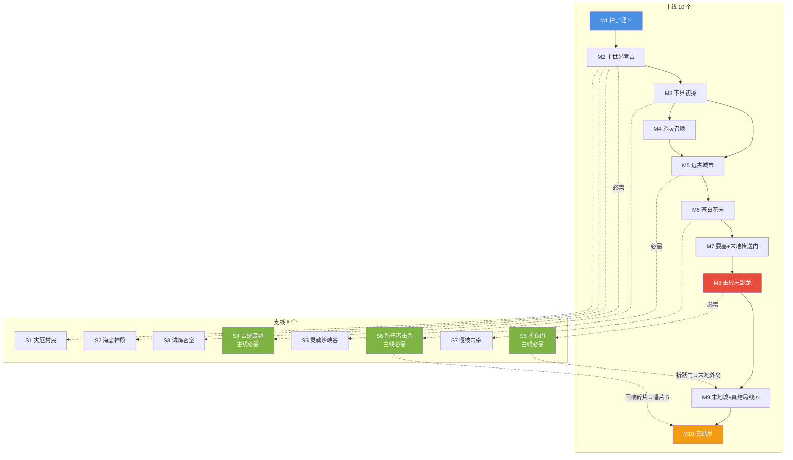

# 28 · 主线与支线划分

> **状态**：🟡 设计讨论中
> **对应模组版本**：v0.1+
> **创建日期**：2026-09-21
> **设计原则**：[原则 0 · L1/L2/L3 判定](./00-planning-index.md#原则-0优先原版实在没辙才自定义且必须与原版有关)
> **关联章节**：[`02-story-timeline-plan`](./02-story-timeline-plan.md) · [`03-player-journey-map`](./03-player-journey-map.md) · [`22-design-questions-answers`](./22-design-questions-answers.md) §Q5 · [`27-choice-impact-design`](./27-choice-impact-design.md)

---

## 1. 目的

按项目方 2026-09-21 指示："主线有几个且串哪些剧情或结构或生物，支线有几个且串哪些剧情或结构或生物"——本文档详细划分主线与支线。

---

## 2. 主线（10 个，按玩家阶段对应）

按 [`03-player-journey-map`](./03-player-journey-map.md) 十阶段路径，**主线 10 个节点**：

| 主线 # | 名称 | 阶段 | 串接剧情 | 关键结构 | 关键生物 | 关键笔记 |
|--------|------|------|----------|----------|----------|----------|
| **M1** | 种子埋下 | 阶段 1 | 玩家出生→拾取笔记 #1 | 村庄考古棚/古碑（按 [`01-spawn-point-design`](./01-spawn-point-design.md)） | 古老图书管理员（L3 自定义 NPC） | #1（M.） |
| **M2** | 主世界考古 | 阶段 2 | 拼凑先民存在 | 沙漠神殿+丛林神庙+废弃矿井+地牢+古迹废墟+埋藏宝藏 | 骷髅+僵尸+苦力怕+蜘蛛+洞穴蜘蛛 | #2/#3/#4/#5/#6/#15/#16/#17/#18 |
| **M3** | 下界初探 | 阶段 3 | 凋灵之灾余波 | 下界要塞+堡垒遗迹+废弃传送门 | 猪灵+猪灵蛮兵+僵尸猪灵+凋灵骷髅+烈焰人+恶魂 | #11/#12/#19/#20/#21/#22 |
| **M4** | 凋灵召唤 | 阶段 4 | 灾变复现 | 下界要塞凋灵召唤阵 | 凋灵（玩家主动召唤） | #19（B. 工程师日志） |
| **M5** | 远古城市 | 阶段 5 | 幽匿之厄 | 远古城市+深暗之域 | 监守者+幽匿 | #14（M. 灵魂能量研究员手记） |
| **M6** | 苍白花园 | 阶段 6 | 苍白之悔 | 苍白花园 | 嘎枝+嘎枝之心 | #18（M. 生命树脂实验最后记录） |
| **M7** | 要塞+末地传送门 | 阶段 7 | 维度穿行最高成就 | 要塞+要塞图书馆+末地传送门 | 末影人（罕见） | #13/#17 |
| **M8** | 击败末影龙 | 阶段 7 | 守门人真相 | 末地岛+末地水晶+回归传送门 | 末影龙 | — |
| **M9** | 末地城+真结局线索 | 阶段 8-9 | 殖民军真相+被遗忘的士兵 | 末地城+末地船+终界岛 | 末影人+潜影贝+末影螨 | #23/#24/#25/#26 |
| **M10** | 真结局 | 阶段 10 | M. 遗言+觉醒为继承者 | 回归传送门旁+0 号唱片合成台 | M.（曾经的 C.） | #26（M. 告别书） |

---

## 3. 主线串接图

---

## 4. 支线（8 个）

按模组叙事，**支线 8 个**：

| 支线 # | 名称 | 触发阶段 | 串接剧情 | 关键结构 | 关键生物 | 关键物品 |
|--------|------|----------|----------|----------|----------|----------|
| **S1** | 灾厄村民 | M2 主世界考古 | 林地府邸+掠夺者前哨站+raid | 林地府邸+掠夺者前哨站 | 掠夺者+卫道士+唤魔者+劫掠兽+恼鬼+女巫 | 不死图腾 |
| **S2** | 海底神殿 | M2 主世界考古 | 先民水下分支研究站 | 海底神殿 | 守卫者+远古守卫者 | 海晶灯+金块+湿海绵 |
| **S3** | 试炼密室 | M2 主世界考古 | 先民挑战设施 | 试炼密室 | 旋风人+沼骸+各种试炼刷怪笼 | 试炼钥匙+Vault 物资 |
| **S4** | 古迹废墟考古 | M2 主世界考古 | 大分裂期撤离记录 | 古迹废墟 | — | 笔记 #15+考古陶片+刷子 |
| **S5** | 灵魂沙峡谷 | M3 下界初探 | 凋灵之灾受害者埋骨地 | 灵魂沙峡谷 | 灾变遗骨（含灵魂沙） | 灵魂沙+灵魂火 |
| **S6** | 监守者击杀（可选） | M5 远古城市 | 幽厄悲剧结束 | 远古城市深处 | 监守者 | 回响碎片（合成唱片 5） |
| **S7** | 嘎枝击杀（可选） | M6 苍白花园 | 防御程序回响结束 | 苍白花园深处 | 嘎枝+嘎枝之心 | 嘎枝之心（活体方块） |
| **S8** | 末地外岛折跃门（可选） | M8 击败末影龙 | 末地城探索引导 | 折跃门 | — | — |

---

## 5. 主线/支线关系矩阵

| 主线节点 | 关联支线 | 支线对主线的影响 |
|----------|----------|------------------|
| M1 种子埋下 | （无） | — |
| M2 主世界考古 | S1 灾厄村民 + S2 海底神殿 + S3 试炼密室 + S4 古迹废墟 | 支线 S4 必经（笔记 #15 必需）；其他可选 |
| M3 下界初探 | S5 灵魂沙峡谷 | 支线 S5 可选 |
| M4 凋灵召唤 | （无） | — |
| M5 远古城市 | S6 监守者击杀 | 支线 S6 影响 0 号唱片合成（需唱片 5=回响碎片） |
| M6 苍白花园 | S7 嘎枝击杀 | 支线 S7 不影响主线，但提供嘎枝之心彩蛋 |
| M7 要塞+末地传送门 | （无） | — |
| M8 击败末影龙 | S8 折跃门 | 支线 S8 是 M9 的物理引导（折跃门→外岛→末地城） |
| M9 末地城+真结局线索 | （无） | — |
| M10 真结局 | （无） | — |

---

## 6. 主线核心物品清单

主线必经的关键物品（按 [`10-custom-items-registry`](./10-custom-items-registry.md) L3 自定义清单）：

| 物品 | 主线 # | 必要性 | 来源 |
|------|--------|--------|------|
| 笔记 #1（残破笔记） | M1 | 必需 | 5 个原版 loot 表（[`09-village-loot-extension`](./09-village-loot-extension.md)） |
| 笔记 #7-#14 | M2-M5 | 必需 | 各遗迹 loot 表追加 |
| 笔记 #15-#18 | M2 | 必需 | 主世界遗迹 loot 表追加 |
| 笔记 #19-#22 | M3 | 必需 | 下界遗迹 loot 表追加 |
| 笔记 #23-#26 | M9-M10 | 必需 | 末地城/末地船/终界岛/回归传送门旁 |
| 0 号唱片 | M10 | 必需 | 22 张原版唱片+下界之星合成 |
| M. 遗言文本 | M10 | 必需 | 0 号唱片播放触发 tellraw |

---

## 7. 支线可选奖励清单

| 支线 | 可选奖励 | 对主线影响 |
|------|----------|------------|
| S1 灾厄村民 | 不死图腾+林地府邸箱子（含唱片 ward） | 不死图腾在 M8 末影龙战中有用 |
| S2 海底神殿 | 海晶灯+金块+湿海绵 | 不影响主线 |
| S3 试炼密室 | 试炼钥匙+Vault 物资（含唱片 Creator/Precipice） | 不影响主线（0 号唱片合成已含 Creator/Precipice） |
| S4 古迹废墟 | 笔记 #15+考古陶片+刷子 | **必需**——笔记 #15 是主线 M2 的关键 |
| S5 灵魂沙峡谷 | 灵魂沙+灵魂火 | 不影响主线 |
| S6 监守者击杀 | 回响碎片（合成唱片 5） | **必需**——唱片 5 是 0 号唱片合成的 22 张原版唱片之一 |
| S7 嘎枝击杀 | 嘎枝之心（活体方块） | 不影响主线，仅作彩蛋 |
| S8 折跃门 | 进入末地外岛 | **必需**——M9 末地城探索的物理引导 |

**关键认知**：S4 古迹废墟、S6 监守者击杀、S8 折跃门虽标为"支线"，但实际是**主线必需的支线**——按 [`27-choice-impact-design`](./27-choice-impact-design.md) 选项 4，这些"主要选项"会稍微改变后续主线（如玩家若不击杀监守者，无法获得回响碎片，无法合成唱片 5，无法合成 0 号唱片）。

---

## 8. 主线/支线 Mermaid 关系图

---

## 9. 与已有规划文档的关联

- [`02-story-timeline-plan`](./02-story-timeline-plan.md) 六大纪元——本章节是主线节点的对应
- [`03-player-journey-map`](./03-player-journey-map.md) 十阶段——本章节是主线 10 节点的来源
- [`22-design-questions-answers`](./22-design-questions-answers.md) §Q5 探险顺序——本章节是其主线/支线划分
- [`27-choice-impact-design`](./27-choice-impact-design.md) 选项影响——本章节是其选项应用范围
- [`10-custom-items-registry`](./10-custom-items-registry.md) L3 自定义物品——本章节是其物品的归属
- [`09-village-loot-extension`](./09-village-loot-extension.md) 笔记 #1-#6——本章节是 M2 笔记的来源

---

## 10. 待讨论的设计问题

- [ ] S4/S6/S8 这 3 个"主线必需的支线"是否应改为主线？倾向：保持支线标签但标注"必需"
- [ ] 支线数量是否需要扩展？倾向：v0.5 后考虑扩展（如更多 Boss 击杀支线）
- [ ] 主线节点 M4 凋灵召唤是否必需？倾向：必需——凋灵骷髅头颅是 0 号唱片合成的下界之星来源

---

## 11. 修订历史

| 日期 | 版本 | 修订内容 | 修订者 |
|------|------|----------|--------|
| 2026-09-21 | v0.1 | 初稿，按项目方 9-21 指示划分主线 10 个+支线 8 个，含主线串接图+主线/支线关系矩阵+主线核心物品清单+支线可选奖励清单+主线/支线 Mermaid 关系图；标注 3 个"主线必需的支线"（S4 古迹废墟/S6 监守者击杀/S8 折跃门） | 项目方 |
