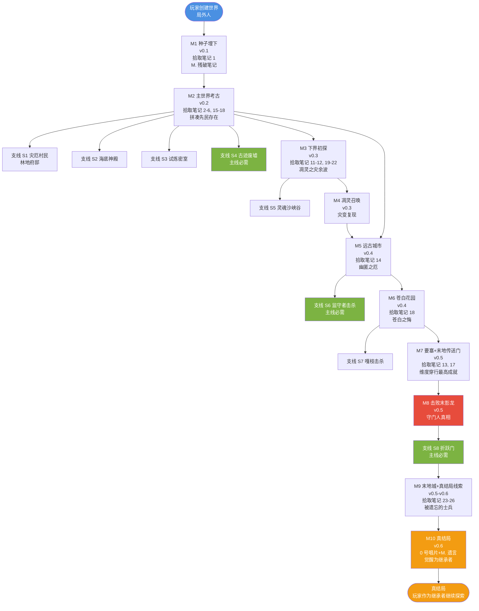

# 29 · 剧情大纲

> **状态**：🟡 设计讨论中
> **对应模组版本**：v0.1+
> **创建日期**：2026-09-21
> **设计原则**：[原则 0 · L1/L2/L3 判定](./00-planning-index.md#原则-0优先原版实在没辙才自定义且必须与原版有关)
> **关联章节**：[`02-story-timeline-plan`](./02-story-timeline-plan.md) · [`03-player-journey-map`](./03-player-journey-map.md) · [`21-narrative-causality-map`](./21-narrative-causality-map.md) · [`27-choice-impact-design`](./27-choice-impact-design.md) · [`28-main-side-quest-design`](./28-main-side-quest-design.md)

---

## 1. 目的

本文档是 **Remnant Echo 模组的剧情大纲**——按主线 10 节点+支线 8 个展开，作为预写剧情（22 张笔记+M. 遗言+微动作描述）的准备。

**与已有规划的关系**：
- [`02-story-timeline-plan`](./02-story-timeline-plan.md) 六大纪元——本章节是开发者视角的"故事时序"
- [`03-player-journey-map`](./03-player-journey-map.md) 十阶段——本章节是玩家视角的"探索顺序"
- [`21-narrative-causality-map`](./21-narrative-causality-map.md) 因果链——本章节是叙事视角的"因果串联"
- [`28-main-side-quest-design`](./28-main-side-quest-design.md) 主线/支线划分——本章节是其剧情展开

**核心约束**：
- 所有剧情基于已有规划文档的逻辑自洽性
- 不引入新设定，仅作剧情可视化
- 严格遵循 L1/L2/L3 原则——本文档是文学性参考，不涉及机制实现

---

## 2. 故事一句话

> **「先民以为自己能控制一切能量，结果发现不能。后裔们继承了他们的失败——但也有人，比如 M.，留下了一句话。」**

---

## 3. 剧情大纲（按主线 10 节点）

### M1 · 种子埋下（v0.1）

**故事**：

玩家创建世界后，作为"局外人"出生在主世界。模组不干预出生逻辑——玩家随机生成。

玩家自由探索时，会发现村庄附近有"考古棚"或"古碑"——这是模组附加的原版方块变体（按 [`01-spawn-point-design`](./01-spawn-point-design.md) 方案 B/C）。

玩家首次进入村庄图书馆时，"古老图书管理员"（L3 自定义 NPC）会递给玩家一份"残破笔记 #1"——笔记 #1 内容：

> 「寻找那座塔。它会告诉你我们是谁。
> 不要相信猪灵。也不要相信我们。
> —— M.」

玩家拾取笔记后，触发 advancement "线索书第 0 章已解锁"——tellraw 显示：

> 「你拾起笔记，纸张泛黄，墨迹模糊。字迹似乎在颤抖——是写的人害怕，还是阅读的人？最后一行有一个符号，像是字母 M。
>
> M. 写下这行字时，手指在颤抖。他听到下界要塞的轰鸣声从远处传来——那是凋灵实验失控的前兆。」

**关键元素**：
- 视觉：粒子环绕笔记+村庄 cat 配乐
- 听觉：book_open 音效+轻柔 cat 配乐
- 微动作：M. 视角 6 段描述
- L 等级：L1（advancement+tellraw+particle+playsound）+ L3（4 个叙事 NPC 之一：古老图书管理员）

### M2 · 主世界考古（v0.2）

**故事**：

玩家在主世界自由探索，自然接触沙漠神殿/丛林神庙/废弃矿井/地牢/古迹废墟/埋藏宝藏等原版遗迹。模组在这些遗迹的 loot 表中追加 written_book 条目（按 [`09-village-loot-extension`](./09-village-loot-extension.md) L1 模式）。

玩家拾取笔记 #2-#6 + #15-#18 后，逐步拼凑出"先民存在"的认知：
- 笔记 #2（沙漠神殿）：祭祀信仰——先民鼎盛期的信仰体系
- 笔记 #3（丛林神庙）：红石机械——先民鼎盛期的研究领域
- 笔记 #4（废弃矿井）：劳工日志——先民社会的劳工阶层
- 笔记 #5（地牢）：监禁记录——先民的"批量生命体生产设施"
- 笔记 #6（先民储藏室，按 01 方案 C）：储藏清单——物资储备、撤离迹象
- 笔记 #15（古迹废墟）：撤退者记录——大分裂期撤离主世界据点
- 笔记 #16（埋藏宝藏）：航海者清单——沿海物资储备
- 笔记 #17（要塞图书馆）：维度穿行技术报告——维度穿行技术的核心
- 笔记 #18（苍白花园）：生命树脂实验最后记录——苍白之悔

收集全部 5 份笔记（#2-#6）后触发 advancement "线索书第 1 章：先民存在已解锁"。

**关键元素**：
- 视觉：每个遗迹有独立配乐+粒子（沙漠 mellohi/丛林 chirp/废弃矿井 13/地牢 blocks/古迹废墟 far/埋藏宝藏 mall）
- 听觉：配乐+开箱音效
- 微动作：每份笔记的落款角色微动作（R. 撤退者/S. 航海者/E. 匠人/M.）
- L 等级：L1（loot 表追加+advancement+tellraw）

### M3 · 下界初探（v0.3）

**故事**：

玩家通过建造下界传送门进入下界。模组通过 advancement 检测玩家首次进入下界，触发 Pigstep 配乐（按 [`26-music-scenario-catalog`](./26-music-scenario-catalog.md) §6.1）。

玩家探索下界要塞（凋灵实验遗址）+堡垒遗迹（猪灵现代文明）+废弃传送门（早期维度穿行尝试）。

拾取笔记 #11-#12 + #19-#22 后，逐步拼凑出"凋灵之灾余波"的真相：
- 笔记 #19（下界要塞）：B. 工程师日志——凋灵实验失控预兆
- 笔记 #20（下界化石）：N. 自然学者——远古生物观察记录
- 笔记 #21（灵魂沙峡谷）：G. 埋葬者——埋葬记录
- 笔记 #22（堡垒遗迹深处）：L. 猪灵领袖——猪灵文明宣言
- 笔记 #11（堡垒遗迹通用箱子）：K. 矿工——矿工记录
- 笔记 #12（堡垒遗迹藏宝室）：T. 提炼者——提炼者笔记

**关键元素**：
- 视觉：下界暗红光谱+凋灵召唤时的红紫色粒子
- 听觉：Pigstep/otherside 配乐+烈焰人火球音效
- 微动作：B./N./G./L./K./T. 视角微动作
- L 等级：L1

### M4 · 凋灵召唤（v0.3）

**故事**：

玩家通过收集凋灵骷髅头颅（在下界要塞凋灵骷髅掉落）+灵魂沙，主动召唤凋灵——重现先民的凋灵实验。

击败凋灵后触发 tellraw："你重现了他们的实验，并活了下来。"——按 [`07-boss-narrative-binding`](./07-boss-narrative-binding.md) §3.1。

凋灵掉落下界之星——这是 0 号唱片合成的必需材料。

**关键元素**：
- 视觉：凋灵死亡瞬间粒子爆发（凋灵玫瑰色）
- 听觉：原版凋灵 BGM+Withering Wave 自创配乐（v0.3 可选）
- 微动作：凋灵视角描述（3 头+灵魂扭曲波）
- L 等级：L1+L2（L3 自创配乐可选）

### M5 · 远古城市（v0.4）

**故事**：

玩家进入深暗之域+远古城市——幽匿之厄的遗址。模组通过 advancement 检测玩家进入远古城市 100 格内，触发 5 号唱片配乐（按 [`26-music-scenario-catalog`](./26-music-scenario-catalog.md) §5.1）。

玩家必须潜行避开监守者（或在监守者追击时逃脱）。监守者追击时切换为 otherside+调速 0.8 配乐。

拾取笔记 #14（M. 灵魂能量研究员手记）后，了解幽匿之厄的真相——"凋灵之灾不是意外，是我们以为自己能控制灵魂能量的全部，结果发现不能。"

玩家可选击杀监守者（按 [`28-main-side-quest-design`](./28-main-side-quest-design.md) S6 主线必需的支线），获得回响碎片合成唱片 5。

**关键元素**：
- 视觉：远古城市 5+otherside 配乐+黑雾粒子（dragon_breath+squid_ink）
- 听觉：监守者追击时心跳音效
- 微动作：监守者视角（钻出+无眼+500 血量）
- L 等级：L1+L2（L3 自创配乐 Sculk Echo 可选）

### M6 · 苍白花园（v0.4）

**故事**：

玩家进入黑暗森林+苍白花园——苍白之悔的遗址。模组通过 advancement 检测玩家进入苍白花园 100 格内，触发 Relic 配乐（按 [`26-music-scenario-catalog`](./26-music-scenario-catalog.md) §5.3）。

玩家必须破坏嘎枝之心才能击败嘎枝——这是模组对原版机制的解读（按 [`02-story-timeline-plan`](./02-story-timeline-plan.md) §5.4）。

拾取笔记 #18（M. 生命树脂实验最后记录）后，了解苍白之悔的真相——生命树脂实验失控导致苍白花园白化。

**关键元素**：
- 视觉：苍白花园 Relic 配乐+白色粒子（pale_oak_sapling+Pale Regret 自创配乐）
- 听觉：嘎枝激活时 Relic 调速 1.2+wood_crack 音效
- 微动作：嘎枝视角（被注视冻结+夜间防御）
- L 等级：L1+L2（L3 自创配乐 Pale Regret 可选）

### M7 · 要塞+末地传送门（v0.5）

**故事**：

玩家寻找要塞（按原版末影之眼定位）。要塞图书馆中可拾取笔记 #13（E. 附魔台匠人日记）——了解附魔台+灵魂能量的真相。

模组通过 advancement 检测玩家进入要塞图书馆，触发 strad 配乐（按 [`26-music-scenario-catalog`](./26-music-scenario-catalog.md) §4.8）。

玩家用 12 个末影之眼激活末地传送门——这是模组"先民维度穿行最高成就"叙事的具象。

**关键元素**：
- 视觉：要塞 stal 配乐+图书馆 strad 配乐切换
- 听觉：末地传送门激活音效
- 微动作：E. 视角（匠人日记）
- L 等级：L1

### M8 · 击败末影龙（v0.5）

**故事**：

玩家进入末地，激活末影龙战。模组通过 advancement 检测玩家首次进入末地，触发 ward 配乐（按 [`26-music-scenario-catalog`](./26-music-scenario-catalog.md) §7.1）。

击败末影龙后触发"守门人真相" tellraw（按 [`07-boss-narrative-binding`](./07-boss-narrative-binding.md) §3.3）——末影龙不是怪物，是先民制造的最终守门人。

End Poem 显示（原版终末诗，公共领域 CC0）。

**关键元素**：
- 视觉：末影龙战原版 BGM+龙息粒子
- 听觉：原版末影龙 BGM+End Poem
- 微动作：末影龙视角（盘旋+紫色翅膀+守护末地传送门）
- L 等级：L1

### M9 · 末地城+真结局线索（v0.5-v0.6）

**故事**：

玩家通过折跃门进入末地外岛，探索末地城+末地船+终界岛。

拾取笔记 #23-#26 后，逐步拼凑出"被遗忘的士兵"真相：
- 笔记 #23（末地城图书馆）：C. 殖民军日志——殖民军初到末地
- 笔记 #24（末地船舱底）：C. 等待接应——大分裂晚期孤立
- 笔记 #25（终界岛中心）：E. 维度穿行技术报告晚期版——末影人随机传送退化机理
- 笔记 #26（回归传送门旁）：M. 告别书——C.=M. 同人真相揭晓

**关键元素**：
- 视觉：末地城 11 配乐+末地船 wait 配乐
- 听觉：潜影贝攻击音效
- 微动作：C./E./M. 视角
- L 等级：L1

### M10 · 真结局（v0.6）

**故事**：

玩家收集全部 22 张原版唱片（含 Lava Chicken 1.21.7 新增，按 [`16-version-updates/06`](../16-version-updates/06-minecraft-1.21.7-dennis-painting.md) §3）+下界之星（凋灵掉落），合成 0 号唱片。

玩家将 0 号唱片放入唱片机——模组触发 L3 自创配乐 `M.'s Farewell`（基于 C418 ambient 风格衍生）+金蓝色 m_farewell 粒子。

M. 遗言 9 段 tellraw 依次显示（按 [`20-end-narrative`](./20-end-narrative.md) §14.2）：
1. "他们不是英雄，不是叛徒，不是怪物。"
2. "他们只是一群完成任务的士兵，在任务完成后发现……"
3. "总部已经不在了。"
4. ...（共 9 段）
9. "这个世界，现在交给你了。—— M.（曾经的 C.）"

End Poem 重新解读（按 [`20-end-narrative`](./20-end-narrative.md) §13）：
- "宇宙由两个灵魂对话创造" = M. 与另一位先民领袖
- "你即宇宙" = 玩家觉醒为继承者

真结局——玩家从"局外人"觉醒为"继承者"。

**关键元素**：
- 视觉：m_farewell 金蓝色粒子+End Poem 显示
- 听觉：L3 自创配乐 M.'s Farewell
- 微动作：M. 视角（最后的告别）
- L 等级：L1+L3（自创配乐+粒子）

---

## 4. 剧情大纲 Mermaid 图

---

## 5. 关键叙事节点

### 5.1 三大灾变（按 [`02-story-timeline-plan`](./02-story-timeline-plan.md) §4.1）

| 灾变 | 触发 | 后果 | 玩家阶段 |
|------|------|------|----------|
| 凋灵之灾 | 先民在下界要塞研究灵魂能量→召唤凋灵失控 | 灵魂扭曲波席卷下界→善魂被污染→下界据点废弃 | M3-M4 |
| 幽匿之厄 | 撤回主世界后集中研究幽匿→幽匿失控 | 监守者诞生→远古城市封印 | M5 |
| 苍白之悔 | 退守苍白花园研究生命本源→生命树脂失控 | 嘎枝诞生→苍白花园白化 | M6 |

### 5.2 真相揭晓（按 [`20-end-narrative`](./20-end-narrative.md) §10）

| 真相 | 揭晓节点 | 揭晓内容 |
|------|----------|----------|
| 三界同源 | M2-M3 | 先民开拓三界，今日村民/猪灵/末影人皆为其后裔 |
| 凋灵之灾 | M3-M4 | 凋灵实验失控，灵魂扭曲波席卷下界 |
| 幽匿之厄 | M5 | 幽匿感知声音后无差别吞噬，监守者诞生 |
| 苍白之悔 | M6 | 生命树脂实验失控，苍白花园白化 |
| 守门人真相 | M8 | 末影龙是先民制造的最终守门人 |
| 被遗忘的士兵 | M9 | 末影人是末地殖民军异化后裔 |
| C.=M. 同人 | M9-M10 | M. 即为先民领袖 C.，在末地等待接应 |
| 玩家觉醒 | M10 | 玩家从局外人觉醒为继承者 |

### 5.3 12 位落款角色

按 [`09-mob-relationships`](../17-lore-extensions/09-mob-relationships.md) + [`12-visual-audio-microaction`](../17-lore-extensions/12-visual-audio-microaction.md)：

| 角色 | 笔记编号 | 视角 |
|------|----------|------|
| M.（先民领袖，曾经的 C.） | #1/#10/#14/#17/#18/#26 | 6 个场景，最关键 |
| H.（守考者） | #7/#8/#9 | 3 个场景 |
| K.（矿工） | #11 | 1 个场景 |
| T.（提炼者） | #12 | 1 个场景 |
| E.（匠人） | #13/#17/#25 | 3 个场景 |
| B.（凋灵实验工程师） | #19 | 1 个场景 |
| N.（自然学者） | #20 | 1 个场景 |
| G.（埋葬者） | #21 | 1 个场景 |
| L.（猪灵领袖） | #22 | 1 个场景 |
| C.（末地殖民军指挥官） | #23/#24 | 2 个场景 |
| R.（撤退者） | #15 | 1 个场景 |
| S.（航海者） | #16 | 1 个场景 |

---

## 6. 剧情所需的资料缺口

按 [`28-main-side-quest-design`](./28-main-side-quest-design.md) + 本章节剧情大纲，标注所需资料缺口：

| 资料 | 当前状态 | 优先级 |
|------|----------|--------|
| 22 张笔记的完整内容 | 🟡 部分已写（#1/#7-#14 等），部分待详化（#2-#6/#15-#18/#19-#26） | ★★★★★ v0.1-v0.6 |
| M. 遗言 9 段完整文本 | 🟡 部分已写（按 [`20-end-narrative`](./20-end-narrative.md) §14.2），待详化 | ★★★★★ v0.6 |
| 4 个 L3 自定义叙事 NPC 的微动作 | 🟡 部分已写（按 [`12-visual-audio-microaction`](../17-lore-extensions/12-visual-audio-microaction.md) §5），待详化 | ★★★★ v0.1 |
| The Sift 第四维度的剧情整合 | 🟡 待 v0.6+ 后启动（按 [`16-version-updates/09`](../16-version-updates/09-minecraft-live-2026-september.md)） | ★★★ v0.6+ |
| Ice Caves 群系的剧情整合 | 🟡 待 v0.5+ 后启动 | ★★ v0.5+ |
| 新僵尸变种的剧情整合 | 🟡 待 v0.5+ 后启动 | ★★ v0.5+ |
| Minecraft Dungeons II 设定参考 | 🟡 待 v1.0 后评估 | ★ v1.0 |

---

## 7. 与已有规划文档的关联

- [`02-story-timeline-plan`](./02-story-timeline-plan.md) 六大纪元——本章节是开发者视角时序
- [`03-player-journey-map`](./03-player-journey-map.md) 十阶段——本章节是玩家视角顺序
- [`21-narrative-causality-map`](./21-narrative-causality-map.md) 因果链——本章节是叙事视角因果
- [`27-choice-impact-design`](./27-choice-impact-design.md) 选项影响——本章节是选项应用范围
- [`28-main-side-quest-design`](./28-main-side-quest-design.md) 主线/支线划分——本章节是其剧情展开
- [`09-village-loot-extension`](./09-village-loot-extension.md) 笔记 #1-#6 内容
- [`14-trial-chamber-narrative`](./14-trial-chamber-narrative.md) 笔记 #7-#10
- [`15-netherite-enchantment-essence`](./15-netherite-enchantment-essence.md) 笔记 #11-#14
- [`18-overworld-narrative`](../planning/18-overworld-narrative.md) 笔记 #15-#18
- [`19-nether-narrative`](../planning/19-nether-narrative.md) 笔记 #19-#22
- [`20-end-narrative`](../planning/20-end-narrative.md) 笔记 #23-#26+M. 遗言
- [`26-music-scenario-catalog`](./26-music-scenario-catalog.md) 33 个配乐节点
- [`12-visual-audio-microaction`](../17-lore-extensions/12-visual-audio-microaction.md) 25 个微动作场景
- [`16-version-updates/09`](../16-version-updates/09-minecraft-live-2026-september.md) The Sift 第四维度
- [`16-version-updates/10`](../16-version-updates/10-minecraft-dungeons-ii.md) Minecraft Dungeons II

---

## 8. 待讨论的设计问题

- [ ] 22 张笔记的完整内容是否需要立即开始整理？倾向：是，按 v0.1-v0.6 分阶段实施（详见 `lore-stories/` 章节，待创建）
- [ ] M. 遗言 9 段是否需要更详细的文学化展开？倾向：是，v0.6 真结局时详化
- [ ] The Sift 第四维度的剧情整合是否阻塞 v0.1？倾向：否，v0.6+ 后启动
- [ ] 是否需要为 4 个 L3 自定义叙事 NPC 写独立的"角色背景故事"？倾向：是，v0.1-v0.5 分阶段实施

---

## 9. 修订历史

| 日期 | 版本 | 修订内容 | 修订者 |
|------|------|----------|--------|
| 2026-09-21 | v0.1 | 初稿，按主线 10 节点+支线 8 个展开剧情大纲，含每节点的故事+视觉+听觉+微动作+L 等级+剧情大纲 Mermaid 图+关键叙事节点+所需资料缺口 | 项目方 |
