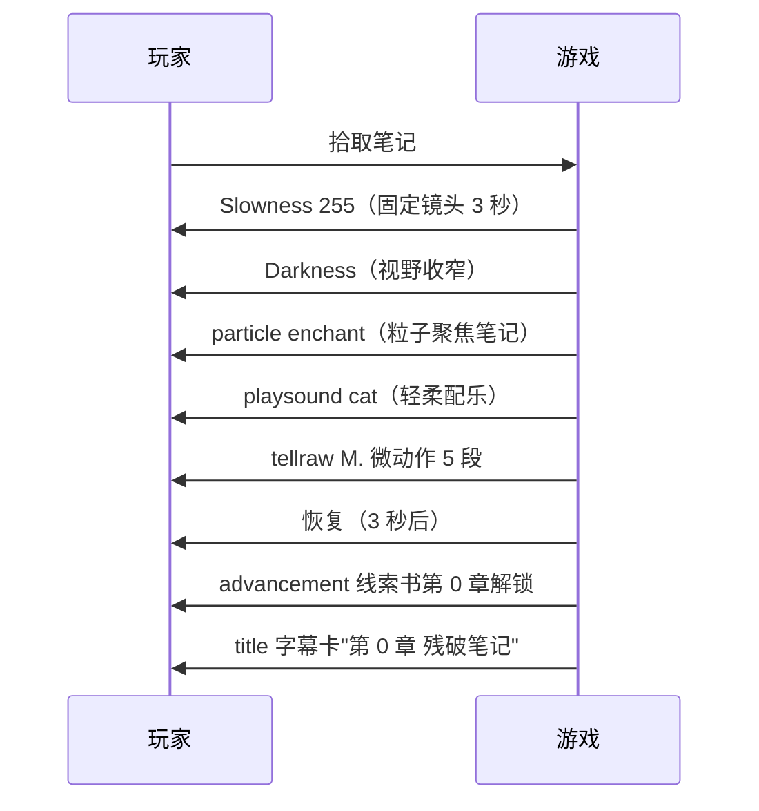
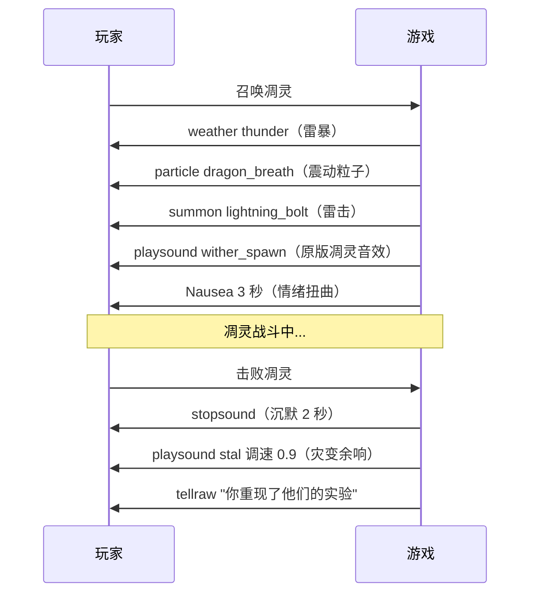
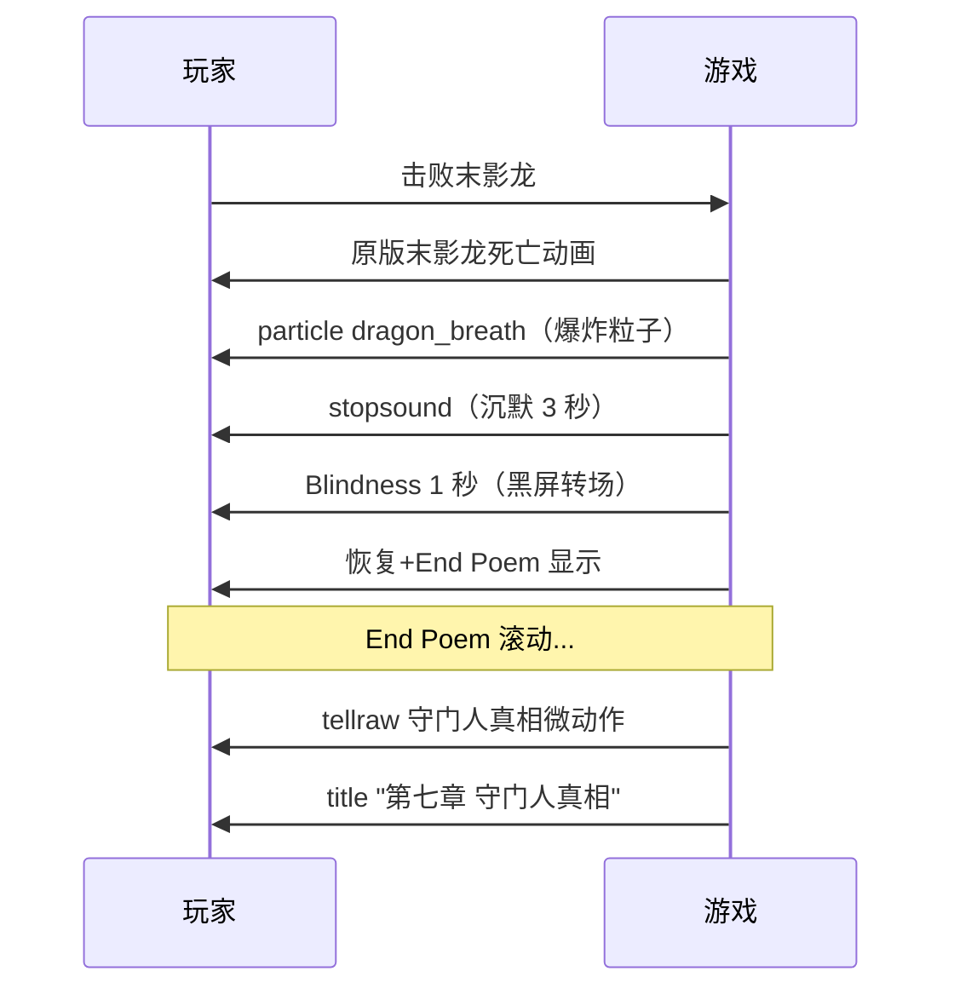
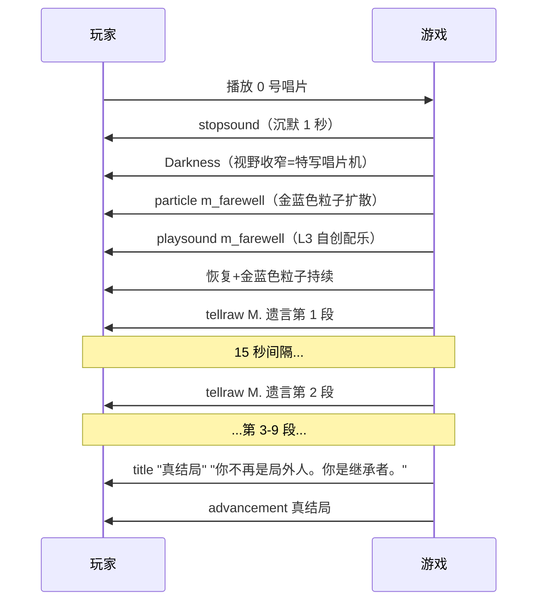
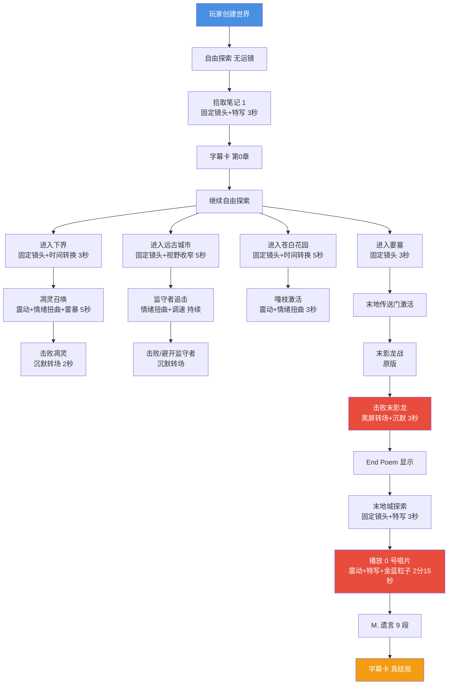

# 30 · 运镜与电影化叙事设计

> **状态**：🟡 设计讨论中
> **对应模组版本**：v0.1+
> **创建日期**：2026-09-21
> **设计原则**：[原则 0 · L1/L2/L3 判定](./00-planning-index.md#原则-0优先原版实在没辙才自定义且必须与原版有关)
> **关联章节**：[`24-design-followups-2`](./24-design-followups-2.md) §Q16 · [`25-design-followups-3`](./25-design-followups-3.md) · [`12-visual-audio-microaction`](../17-lore-extensions/12-visual-audio-microaction.md)

---

## 1. 目的

回答项目方 2026-09-21 提出的"运镜方面"需求——如何在不使用预渲染视频/录制回放的前提下，通过原版机制实现"电影化运镜"效果。

**核心约束**：
- ❌ 不使用预渲染视频（违反原则0+原则3）
- ❌ 不使用录制类模组代码（如 Frametica/Immersive Cinematics——违反原则0"新机制"）
- ✅ 通过原版 particle + /playsound + /time set + /weather + /effect + /title + tellraw 实现"运镜"感

---

## 2. 社区先例

### 2.1 Frametica 模组

- **来源**：modrinth.com
- **原文链接**：<https://modrinth.com/project/aN5phUD8>
- **功能**：通过放置路径点记录摄像机路径，然后重放为平滑的电影化运动
- **模组处理**：❌ 不采纳——客户端新机制，违反原则0

### 2.2 Immersive Cinematics 模组

- **来源**：modpackindex.com
- **原文链接**：<https://www.modpackindex.com/mod/109246/immersive-cinematics>
- **发布日期**：2026-07-26
- **功能**：可编写剧本的过场动画——摄像机位置/yaw/pitch/roll/FOV/zoom 可控
- **模组处理**：❌ 不采纳——新机制，违反原则0

### 2.3 Cinematic Camera 模组包

- **来源**：curseforge.com
- **原文链接**：<https://www.curseforge.com/minecraft/modpacks/cinematic-camera>
- **发布日期**：2024-12-19
- **功能**：用于创建平滑专业的电影化镜头
- **模组处理**：❌ 不采纳——新机制，违反原则0

---

## 3. 运镜策略：原版机制模拟"电影化"

### 3.1 原版可用的"运镜"工具

| 工具 | 原版命令 | "运镜"效果 |
|------|----------|------------|
| **Slowness 效果** | `/effect give @s minecraft:slowness 5 255 true` | 玩家移动被冻结=固定镜头 |
| **Blindness 效果** | `/effect give @s minecraft:blindness 1 255 true` | 短暂黑屏=镜头切换 |
| **Nausea 效果** | `/effect give @s minecraft:nausea 3 1 true` | 屏幕扭曲=情绪波动运镜 |
| ** Darkness 效果** | `/effect give @s minecraft:darkness 5 1 true` | 视野收窄=特写镜头感 |
| **Time set** | `/time set night` | 时间变化=情绪转换 |
| **Weather** | `/weather thunder` | 雷暴=紧张感运镜 |
| **Particle** | `/particle` | 粒子环绕=视觉聚焦 |
| **Title** | `/title @s title {"text":"..."}` | 全屏文字=字幕卡 |
| **Subtitle** | `/title @s subtitle {"text":"..."}` | 副标题=电影字幕 |
| **Fade** | `/title @s times 20 100 20` | 淡入淡出=镜头转场 |
| **Playsound** | `/playsound` | 配乐=电影音轨 |
| **Stopsound** | `/stopsound` | 声音暂停=沉默转场 |
| **Camera shake（通过粒子模拟）** | `/particle minecraft:dragon_breath ~ ~ ~ 5 0 5 0 30` | 大量粒子=镜头震动感 |

### 3.2 "运镜"技术清单

#### 技巧 1：固定镜头（Fixed Shot）

**实现**：Slowness 255 等级 5 秒 + tellraw 显示叙事文本

```mcfunction
# 固定镜头 5 秒
effect give @s minecraft:slowness 5 255 true
effect give @s minecraft:jump_boost 5 128 true
# 叙事文本
tellraw @s {"text":"你站在远古城市的入口，黑雾从地面升腾。","color":"gray","italic":true}
# 5 秒后恢复
schedule function remnant:camera/restore 100t
```

**适用场景**：玩家首次进入远古城市/苍白花园/末地城等关键遗迹

#### 技巧 2：黑屏转场（Cut Transition）

**实现**：Blindness 1 秒 + 配乐切换 + 声音暂停

```mcfunction
# 黑屏 1 秒
stopsound @s
effect give @s minecraft:blindness 1 255 true
# 1 秒后切换场景配乐
schedule function remnant:camera/cut_transition 20t
```

**适用场景**：击败末影龙→End Poem 显示前的转场

#### 技巧 3：情绪扭曲（Emotional Distortion）

**实现**：Nausea 3 秒 + 配乐调速

```mcfunction
# 情绪扭曲 3 秒
effect give @s minecraft:nausea 3 1 true
# 配乐调速 0.8（压迫感）
playsound minecraft:music_disc_5 master @s ~ ~ ~ 0.6 0.8
```

**适用场景**：监守者追击/凋灵召唤/0 号唱片播放

#### 技巧 4：视野收窄（Close-Up）

**实现**：Darkness 5 秒 + 粒子聚焦

```mcfunction
# 视野收窄 5 秒
effect give @s minecraft:darkness 5 1 true
# 粒子聚焦在叙事对象上
particle minecraft:end_rod ~ ~1 ~ 0.2 0.2 0.2 0 10
```

**适用场景**：玩家拾取笔记时的"特写"效果

#### 技巧 5：字幕卡（Title Card）

**实现**：/title 命令显示全屏文字+淡入淡出

```mcfunction
# 字幕卡
title @s times 20 100 20
title @s title {"text":"第一章","color":"gold","bold":true}
title @s subtitle {"text":"先民存在","color":"gray","italic":true}
```

**适用场景**：每章线索书解锁时显示章节标题

#### 技巧 6：时间转换（Time Shift）

**实现**：/time set 切换昼夜

```mcfunction
# 从白天切换到夜晚（营造紧张感）
time set night
weather thunder
```

**适用场景**：凋灵召唤时/苍白花园进入时

#### 技巧 7：沉默转场（Silence Cut）

**实现**：stopsound + 3 秒空白 + 新配乐

```mcfunction
# 沉默 3 秒
stopsound @s
# 3 秒后播放新配乐
schedule function remnant:camera/silence_to_music 60t
```

**适用场景**：击败末影龙→死亡瞬间→End Poem 显示

#### 技巧 8：震动镜头（Shake Cam）

**实现**：大量 dragon_breath 粒子+雷暴

```mcfunction
# 震动镜头
particle minecraft:dragon_breath ~ ~1 ~ 5 0 5 0 50
weather thunder
# 雷击效果
summon lightning_bolt ~ ~3 ~
```

**适用场景**：凋灵召唤时/0 号唱片播放瞬间

---

## 4. 关键场景运镜设计

### 4.1 M1 种子埋下——固定镜头+特写



### 4.2 M4 凋灵召唤——震动+情绪扭曲



### 4.3 M8 击败末影龙——黑屏转场+沉默+End Poem



### 4.4 M10 真结局——震动+特写+金蓝粒子+M. 遗言



---

## 5. 运镜时序总表

| 场景 | 运镜技巧 | 时长 | 配乐 | 粒子 | tellraw |
|------|----------|------|------|------|---------|
| M1 拾取笔记 #1 | 固定镜头+特写 | 3 秒 | cat | enchant+note | M. 微动作 5 段 |
| M2 探索主世界遗迹 | 无运镜（自由探索） | — | 按遗迹切换 | — | 笔记拾取时简短 tellraw |
| M3 进入下界 | 固定镜头+时间转换 | 3 秒 | Pigstep | — | "你踏入了下界" |
| M4 凋灵召唤 | 震动+情绪扭曲+雷暴 | 5 秒 | wither_spawn→stal | dragon_breath | "灾变余响" |
| M5 进入远古城市 | 固定镜头+视野收窄 | 5 秒 | 5 | dragon_breath+squid_ink | "幽匿之厄" |
| M5 监守者追击 | 情绪扭曲+调速配乐 | 持续 | otherside 调速 0.8 | 持续 sculk_echo | 持续心跳 tellraw |
| M6 进入苍白花园 | 固定镜头+时间转换 | 5 秒 | Relic | pale_oak_sapling | "苍白之悔" |
| M6 嘎枝激活 | 震动+情绪扭曲 | 3 秒 | Relic 调速 1.2 | wood_crack | "防御程序回响" |
| M7 进入要塞 | 固定镜头 | 3 秒 | stal | enchant | "维度穿行最高成就" |
| M8 击败末影龙 | 黑屏转场+沉默 | 3 秒+End Poem | 原版→ward | dragon_breath | 守门人真相 |
| M9 进入末地城 | 固定镜头+特写 | 3 秒 | 11 | end_rod | "殖民军据点" |
| M10 播放 0 号唱片 | 震动+特写+金蓝粒子 | 2 分 15 秒 | M.'s Farewell | m_farewell | M. 遗言 9 段 |

---

## 6. 运镜 Mermaid 总图



---

## 7. 与已有规划文档的关联

- [`24-design-followups-2`](./24-design-followups-2.md) §Q16 预渲染视频否决——本章节是其替代方案的具体实现
- [`25-design-followups-3`](./25-design-followups-3.md) 命令工程化 E1/E2/E3——本章节的运镜实现属于 E2（Java 封装 function 调用）
- [`12-visual-audio-microaction`](../17-lore-extensions/12-visual-audio-microaction.md) 视觉+听觉+微动作——本章节是其"运镜"维度的扩展
- [`26-music-scenario-catalog`](./26-music-scenario-catalog.md) 配乐场景——本章节的运镜时序与配乐时序同步
- [`29-story-outline`](./29-story-outline.md) 剧情大纲——本章节是其运镜维度的具体化

---

## 8. 待讨论的设计问题

- [ ] Slowness 255 是否会被玩家视为"卡 bug"而非"运镜"？倾向：配合粒子+配乐+tellraw 同步，让玩家感知到"这是刻意的设计"
- [ ] Blindness 黑屏转场是否过于突兀？倾向：1 秒即可，配合声音暂停形成"呼吸感"
- [ ] Nausea 情绪扭曲是否让玩家不适？倾向：仅 3 秒，配合关键场景（如凋灵召唤/0 号唱片播放）
- [ ] 字幕卡 /title 是否过于"打断游戏"？倾向：仅在章节解锁时使用，不在普通笔记拾取时使用

---

## 9. 修订历史

| 日期 | 版本 | 修订内容 | 修订者 |
|------|------|----------|--------|
| 2026-09-21 | v0.1 | 初稿，基于 4 次真实 web 搜索（Frametica/Immersive Cinematics/Cinematic Camera 模组先例）+ 原版机制分析，提出 8 种运镜技巧（固定镜头/黑屏转场/情绪扭曲/视野收窄/字幕卡/时间转换/沉默转场/震动镜头）+ 4 个关键场景运镜设计（M1/M4/M8/M10）+ 运镜时序总表+Mermaid 总图 | 项目方 |
